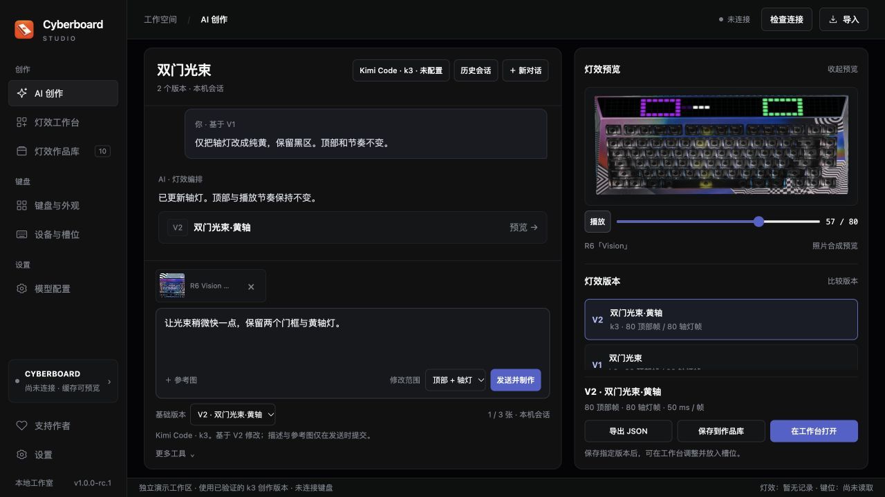
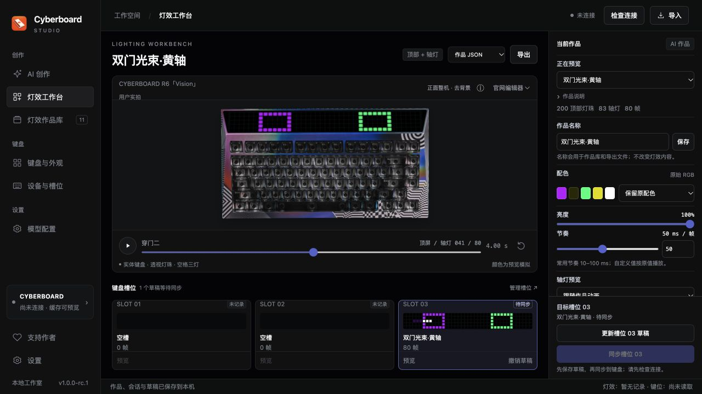
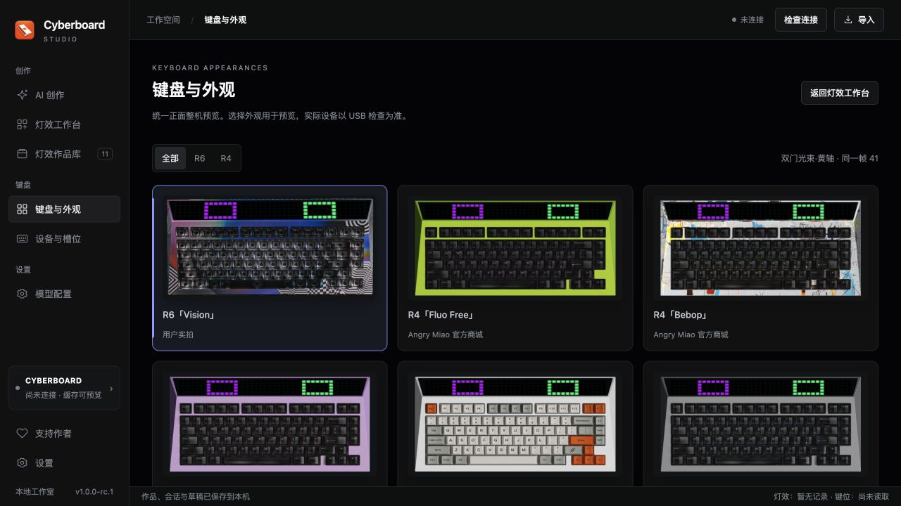

# Cyberboard Studio

[简体中文](README.md) · **English**

**A third-party Angry Miao keyboard tool for CYBERBOARD R4 / CYBERBOARD R6, on macOS and Windows.**

Create top-matrix and key-backlight animations through a dedicated AI conversation with Kimi, MiniMax or DeepSeek. Compare versions on real keyboard photographs, then adjust and synchronize a chosen version to a specific slot in the lighting workbench.

[Download and release history](https://github.com/maestrokaka/cyberboard-studio/releases) · [Full user guide (Chinese)](docs/USER_GUIDE.md) · [Report an issue](https://github.com/maestrokaka/cyberboard-studio/issues) · [Support the author](#support-the-author)

The current build is **1.0.0-rc.1**, a release candidate for testing. Windows native GUI / USB and R4 writes still need hardware acceptance testing. See the [candidate notes](docs/RELEASE_1.0.0_RC1.md) for the current scope. The app interface remains in Chinese.

## See it in action

This 77-second demo shows appearance selection, lighting previews, Kimi k3 creation with a reference image and synchronization to slot 03, ending with footage of the R6 keyboard. Generation and transfer waits are sped up. The video uses an earlier interface; the candidate separates AI creation, the workbench and keyboard appearances into dedicated pages.

https://github.com/user-attachments/assets/8289f982-09d3-45df-9ce7-5f7723c0da52

[Candidate packages and notes](https://github.com/maestrokaka/cyberboard-studio/releases/tag/v1.0.0-rc.1)

## Built-in lighting GIFs

I've created and refined **ten lighting designs with AI**, and included them in the app. You can preview and use them without configuring a model, then sync your favorites to the keyboard.

To make something of your own, connect **Kimi, MiniMax or DeepSeek**, describe your idea, and let AI help you create it.

If there's a theme, character or effect you'd love to see, [leave me a suggestion in GitHub Issues](https://github.com/maestrokaka/cyberboard-studio/issues). Add a short description or reference image—the next built-in design might start with your idea.

The ten full-keyboard previews below follow the app's order. Click a GIF for a larger view.

| Preset | Preset |
| --- | --- |
| **01 Neon Rift · 裂隙超载**<br>Cyan-purple armor and rift transitions · 7.68 s<br><a href="docs/previews/neon-rift.gif"></a> | **02 Data Storm · 数据暴雨**<br>Green data particles and rain · 7.68 s<br><a href="docs/previews/data-storm.gif"></a> |
| **03 Redline Rush · 红线竞速**<br>Red-white trails and speed · 7.68 s<br><a href="docs/previews/redline-rush.gif"></a> | **04 EVA Awakening · EVA初号机 · 觉醒序列**<br>Purple-green armor, eyes and awakening stages · 4.8 s<br><a href="docs/previews/eva-awakening.gif"></a> |
| **05 Glitch Override · 故障字标 · 终端夺权**<br>Wide cyberpunk lettering and glitch transitions · 4.8 s<br><a href="docs/previews/glitch-override.gif"></a> | **06 Mario · 马里奥 · 红帽闯关**<br>Pure-red cap and pixel adventure · 4.2 s<br><a href="docs/previews/mario-run.gif"></a> |
| **07 Cat Chasing Fireflies · 猫逐萤火**<br>A cat chasing fireflies · 6 s<br><a href="docs/previews/cat-firefly.gif"></a> | **08 Kaká Rossonero 22 · 卡卡 · 红黑22**<br>Player card, portrait, name and number · 4.8 s<br><a href="docs/previews/kaka-rossonero.gif"></a> |
| **09 Kaká Breakaway · 卡卡 · 极速突破**<br>Dribbling action and a clear KAKA 22 title · 4.8 s<br><a href="docs/previews/kaka-breakaway.gif"></a> | **10 Kaká San Siro · 卡卡 · 圣西罗之夜**<br>Celebration pose and red-white flags · 4.8 s<br><a href="docs/previews/kaka-san-siro.gif"></a> |

<details>
<summary>About these previews</summary>

Each animation uses a background-removed, front-view CYBERBOARD R6 Vision photograph, with top-matrix and key lighting composited by the app's preview renderer. The full original loop timing and source RGB are unchanged. GIF encoding may introduce slight color differences; these photo-composited screen previews are not hardware color calibration. [GIF verification manifest](docs/previews/manifest.json) · [Kaká design notes — Chinese](docs/LIGHTING_DESIGN_NOTES.md)

</details>

## Screenshots

The primary workflow is **AI creation → lighting workbench → device sync**. Screenshots use a separate demonstration workspace with no personal keys or device records.

### AI creation

The conversation is the main surface, alongside a collapsible photo preview and independent versions. Choose a fixed base version and modify both regions, only the top matrix or only the backlight. History and search live inside this page. A generated version enters the library only when you explicitly save it.



### Lighting workbench

The large photo preview, brightness / timing controls and all three slot drafts share one page. Selecting a slot chooses an assignment target; its Preview action loads its contents, and Undo Draft removes the local draft. Switching conversations does not clear slot drafts.



### Keyboard appearances

Eight front-view photo cards can be filtered by R4 / R6 and compared using the same design and frame. Appearance selection changes the preview only; the connected device is identified separately by a manual USB check.



The catalog contains **R6「Vision」** and **R4「Fluo Free」「Bebop」「Gangstar」「Cloud White V2」「Stone Face」「Paisley」「Vision」**. R6 uses the earliest provided photograph; R4 photos come from Angry Miao's official site or store, including qualifying photos of sold-out colorways. [Sources and calibration](data/photos/official-photo-sources.json)

Model connections have their own page. Devices provides sub-tabs for slots, read-only keymaps and sync records. The library retains search, naming, trash and restoration; all ten built-in designs can be removed locally.

## Download and install

| Package | Target | Installation |
| --- | --- | --- |
| `Cyberboard-Studio-1.0.0-rc.1-macOS-AppleSilicon.zip` | Apple Silicon Mac, macOS 13+ | Extract and move `Cyberboard Studio.app` to Applications |
| `Cyberboard-Studio-1.0.0-rc.1-Windows-x64.zip` | Windows 11 x64; some .NET 10-supported Windows 10 LTSC / Enterprise editions | Extract everything and run `Cyberboard Studio.exe`; retain DLLs and `resources` |
| `Cyberboard-Studio-1.0.0-rc.1-Windows10-Compatibility-x64.zip` | Older Windows 10 with a confirmed CET startup error | Extract separately; only this package removes the app CET marker |

Download ZIPs and SHA-256 files from [v1.0.0-rc.1 Assets](https://github.com/maestrokaka/cyberboard-studio/releases/tag/v1.0.0-rc.1). CLI and runtime components are bundled. Windows needs WebView2; if missing, run `Dependencies/MicrosoftEdgeWebview2Setup.exe` with an internet connection. Intel Mac, 32-bit Windows and native Windows ARM64 packages are not available.

The Mac package uses an ad-hoc signature and has no Apple Developer ID signature or notarization. See [Apple's instructions for opening apps](https://support.apple.com/en-gb/102445). Windows native launch, key-file operations and USB still need acceptance testing for this candidate. For Unknown Hard Error, run the bundled startup diagnostic before choosing the compatibility package; use it only when the logs identify CET. Updating Windows and using the standard package is preferred.

Previous releases remain available in [Releases](https://github.com/maestrokaka/cyberboard-studio/releases). Close the old app before updating. On the first successful save of the new workspace, `workspace-before-1.0.json` preserves the previous workspace. Existing works, trash, removal records and slot drafts remain. Updating does not write to the keyboard.

## Quick start

1. In Model connections, select a provider, region and permitted model, then paste your API key and save. Keys are hidden by default, with a Show / Hide button; each provider uses a plain local key file.
2. Open AI creation. Write a description, add up to three images, or use both. For example: “Orange-red flames rise from below, with ember-like backlights, on a four-second loop.”
3. Send and create, then preview a completed version. For the next turn, choose the base and region: “Only change the backlights to pure yellow; keep the top unchanged.”
4. Explicitly save the chosen version to the library, or open it in the workbench. Assign a slot draft, review the sync plan, then confirm the write.

Kimi Code defaults to `k3`, Kimi Open Platform to `kimi-k3`, new MiniMax connections to `MiniMax-M3.1-Flash-Preview`, and DeepSeek to `deepseek-flash`. Existing saved model choices remain. M3.1 Flash needs the appropriate plan; image support and access depend on the account and model.

Generation sends the current description, selected normalized images, a short text history and an explicitly chosen base recipe. It excludes the full workspace, keymap and device configuration. Another work's style is included only when opted into. Local checks allow at most one repair request; cancellation, failure and repairs may still consume credits. Preview the full loop before saving or syncing.

For first-time setup, the app needs a trusted complete record from a previous successful CLI write to **the same physical keyboard**. JSON artwork import does not establish this device baseline. With no baseline, initialization preserves and verifies the current 1,400 keycodes but replaces unknown lighting and other modes; independent macros, swapped keys and remap tables cannot be preserved. Read the [first-time setup instructions](docs/USER_GUIDE.md#first-setup) before confirming.

## Features and current scope

- Persistent conversations, reference images, drafts and immutable lighting versions; fixed-base, scoped editing, retry, stop, comparison and selected-version export / save.
- Kimi, MiniMax and DeepSeek connections. DeepSeek separates useful-output, reasoning and transport limits; MiniMax accepts a complete `stop` when the stream closes and uses revised M3 thinking parameters. Incomplete output is still rejected.
- Ten built-in designs and eight calibrated front-view photo appearances. No model key is required to preview presets.
- Brightness, timing, palette variants, JSON import / export, naming, search, trash and confirmed permanent deletion.
- Three independent slot drafts, single-slot or explicit all-pending sync, backups and local records.
- R4 / R6 identification, read-only inspection of 81 physical keys across seven layers, and clock synchronization using Asia/Shanghai (UTC+8).

Firmware updates, key remapping, general image generation and video export are not included. Offline checks and earlier live-provider tests do not establish Windows hardware compatibility or R4 USB acceptance; the [candidate notes](docs/RELEASE_1.0.0_RC1.md) distinguish these results.

## Local data

| Data | macOS | Windows |
| --- | --- | --- |
| Conversations, versions, images, works, drafts, trash, plans and backups | `~/Library/Application Support/Cyberboard Studio/` | `%LOCALAPPDATA%\Cyberboard Studio` |
| CLI device records | `~/.local/share/cyberboard-cli/devices/` | `%LOCALAPPDATA%\cyberboard-cli\devices` |

The v2 `workspace.json` keeps conversations, normalized images and full versions locally. The upgrade backup `workspace-before-1.0.json` is private data too. Saving must finish before success is reported; exit and reload wait for pending saves. Limits are 20 conversations, 12 versions and 60 turns per conversation, and 32 MiB for the full workspace. Export useful versions before deleting old records; records are never silently evicted.

Keys are stored directly in `ai-keys/<provider>.key`, separately from `ai-settings.json`, works and workspace files. Legacy Keychain / DPAPI entries are never read, decrypted, migrated or deleted; paste the key again if it exists only there. Keys, private images, device records and workspace backups stay out of source commits and release packages.

## Building and contributing

The repository includes vendored `cyberboard-cli` 0.1.2 with R6 and cross-platform patches. See [CLI provenance and licenses](vendor/README.md).

Mac builds require Python 3.12, Node.js and Xcode Command Line Tools:

```sh
python3 scripts/setup-cli.py --env-dir .tools/macos-build --with-pyinstaller
.tools/macos-build/bin/python scripts/build-macos-backend.py
python3 scripts/prepare-data.py
native/build.sh --backend-dir build/macos-backend/CyberboardBackend
```

The resulting app is `build/Cyberboard Studio.app`. Windows builds use .NET 10 SDK; see the [Windows runtime build notes](windows/runtime-readme.txt) and [package build instructions in Chinese](README.md#从源码构建).

Optionally rebuild the ten photo-composited GitHub GIFs using Python with Pillow installed, Node.js and `@napi-rs/canvas`. From the repository root:

```sh
npm install --prefix .tools/gif-render @napi-rs/canvas
python scripts/build-preset-gifs.py
```

The renderer checks `.tools/gif-render/node_modules` by default; use `STUDIO_CANVAS_MODULE` to select another Canvas module. It uses the app's preview engine and writes temporary PNGs only under `build/`, which stays out of uploads. This is a publishing tool, not an app video-export feature.

Tests use synthetic device configurations and HTTP substitutes. They do not access USB or consume model credits. See the [offline checks](README.md#离线验证). Personal device records, credentials, backups and workspace data must stay out of commits and release packages.

For bugs or suggestions, [open an issue](https://github.com/maestrokaka/cyberboard-studio/issues) with your app version, operating system, keyboard model and steps to reproduce the problem.

---

## Support the author

**Your keyboard is glowing. My coffee cup could use a refill. ☕**

If Cyberboard Studio helped bring your keyboard to life, you're welcome to buy **Kakà** a coffee and fuel the next lighting idea. Any amount is appreciated. Support is optional and does not affect access to features.

<p align="center">
  <a href="docs/assets/wechat-support.svg"></a>
  <br />
  <strong>Scan with WeChat · Kakà</strong>
</p>

For questions and suggestions, email [maestrokaka@gmail.com](mailto:maestrokaka@gmail.com). Please use email or GitHub Issues for feedback rather than payment messages.

**Would you like an English-language version of the app? Please contact me at [maestrokaka@gmail.com](mailto:maestrokaka@gmail.com).**
