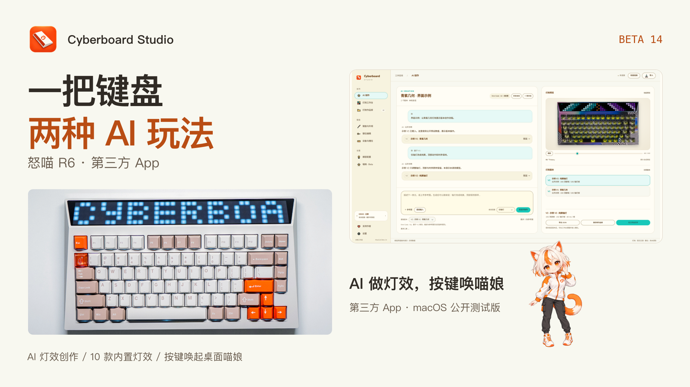

# Cyberboard Studio · MiaoCall Beta 14

[简体中文](README.md) · **English**

A third-party **CYBERBOARD R4 / R6** studio: create lighting through AI conversations, compare versions on real keyboard photographs, and review a plan before syncing. The optional MiaoCall beta turns a held key and a voice instruction into a limited local Codex task.

**[Download Beta 14 · macOS Apple Silicon](https://github.com/maestrokaka/cyberboard-studio/releases/tag/v1.0.0-miaocall.beta.14-public)** · [Release notes](docs/RELEASE_NOTES_MIAOCALL_BETA14.md) · [User guide — Chinese](docs/USER_GUIDE.md) · [Report an issue](https://github.com/maestrokaka/cyberboard-studio/issues)

This is a **public preview** of the previously separate MiaoCall development version. It includes dictation, keymap editing, both interface styles and fixes through Beta 14. The new downloadable package is macOS-only. Windows RC2 packages remain available as explicitly older builds.

## What's included

- **AI lighting:** Kimi, MiniMax and DeepSeek connections; text and up to three reference images; saved conversations, immutable versions and scoped edits.
- **Lighting workbench:** photo-composited previews, brightness / timing / palette controls, three independent slot drafts and reviewed sync plans. Ten removable presets work without a model key.
- **Keyboard appearances:** eight calibrated front photographs, with the same design and moment shown across them. Beta 14 specifically improves AI Creation → Appearances: the page paints first, preparation yields and can be cancelled, and each card compiles only its displayed frame.
- **Two styles:** Classic Dark and Warm Island Light, switchable in Settings and retained after restart without changing artwork RGB or slot drafts.
- **Keymap editor:** readable functions for 81 physical keys across seven layers, local drafts and a separate reviewed write plan. Unknown raw codes are preserved.
- **AI dictation:** separately configure a supported MiniMax, Qwen or OpenAI ASR model, review the transcript, then explicitly send it to create lighting.
- **MiaoCall beta:** hold the physical `·` key on macOS to speak. A draggable catgirl overlay shows listening and task progress. The shortcut starts off and is registered only when enabled.

## Video tour · Bilibili edition

The **3:07** Beta 14 landscape video introduces two workflows: creating your own lighting with AI and calling the desktop companion from a key. It covers references, dictation, version edits, the workbench, slot preparation, appearances and keymaps in the current Warm Island Light interface, with Chinese narration, captions and background music.

[](https://github.com/maestrokaka/cyberboard-studio/releases/download/v1.0.0-miaocall.beta.14-public/Cyberboard-Studio-Beta14-Bilibili-Web.mp4)

**[View the Bilibili-edition video · 3:07 · 720p](https://github.com/maestrokaka/cyberboard-studio/releases/download/v1.0.0-miaocall.beta.14-public/Cyberboard-Studio-Beta14-Bilibili-Web.mp4)**

GitHub hosts a compressed preview, without the original-quality download or editing sources. Lighting uses photo-composited previews; the MiaoCall segment illustrates the workflow. See below for the supported connection scope.

## Screenshots

### Warm Island Light · AI creation


### Classic Dark · lighting workbench


### Appearance selection


Screenshots use a separate interface demonstration environment with no personal keys, conversations or device records. Keyboard photographs are composited with the source lighting; this is not hardware color calibration.

## Downloads

| Platform / version | Download | Scope |
| --- | --- | --- |
| **macOS · Beta 14** | [Current public package and SHA-256](https://github.com/maestrokaka/cyberboard-studio/releases/tag/v1.0.0-miaocall.beta.14-public) | Apple Silicon, macOS 13+; CLI and runtime included |
| Windows · **older RC2** | [RC2 standard x64 / Windows 10 compatibility packages](https://github.com/maestrokaka/cyberboard-studio/releases/tag/v1.0.0-rc.2) | Earlier lighting build, without the new UI, dictation or MiaoCall; native GUI / USB still need hardware testing |

On Mac, download `Cyberboard-Studio-1.0.0-miaocall.beta.14-macOS-Apple-Silicon.zip`, extract it and move the app to Applications. GitHub's Source code archive is for development; `.zip.sha256` is the checksum file. No separate Python installation is required. There is no new Intel Mac, 32-bit Windows or native Windows ARM64 package.

The Mac app is ad-hoc signed, without Apple Developer ID signing or notarization. Follow [Apple's app-opening instructions](https://support.apple.com/en-gb/102445). Microphone, global-key and Spotify automation access are requested when the corresponding feature is explicitly enabled. Quit the old app before upgrading and retain one fixed signed copy. [Setup and permission guide — Chinese](docs/MIAOCALL_BETA.md)

## Quick start

1. Open the workbench and preview a built-in effect without a model key.
2. Configure Kimi, MiniMax or DeepSeek under Model Configuration.
3. Start an AI conversation with text or reference images, such as “orange flames rising from below, ember-like key lighting, four-second loop.”
4. Choose a base version and edit scope, such as “only make the key backlight pure yellow; keep the top unchanged.” Earlier versions remain intact.
5. Save the chosen version or open it in the workbench, prepare a slot draft, inspect the device and plan, then confirm the write.

Requests send your description and selected reference images only when you click Create. Provider keys are stored in ordinary local files, masked by default with a Show / Hide control. Legacy Keychain / DPAPI records are never accessed or migrated.

## MiaoCall: hold a key and speak

Install and sign in to local Codex and Spotify. Separately configure an ASR service such as MiniMax `asr-1.0`, using the region that matches your key. In MiaoCall, provide a track title, artist and Spotify share link, apply the configuration, then enable the shortcut. Hold `·`, speak and release; the transcript is confirmed before execution by default.

Codex uses the official local app-server with an **independent temporary task**. This beta exposes only configured-track Spotify playback and status tools, and verifies the target track, playing state and progress before reporting success. It does not search the whole catalog or execute arbitrary desktop tasks. WorkBuddy, Qwen Office and Doubao Work are placeholders, not connected agents.

When disabled, the key types normally. The global shortcut never starts automatically and is released on exit. Desktop voice / overlay support is currently macOS-only. [Full setup and troubleshooting — Chinese](docs/MIAOCALL_BETA.md) · [Keymap and dictation guide — Chinese](docs/KEYMAP_VOICE_LOCAL.md)

## Built-in lighting GIFs


I've created and refined **ten lighting designs with AI**, and included them in the app. You can preview and use them without configuring a model, then sync your favorites to the keyboard.

To make something of your own, connect **Kimi, MiniMax or DeepSeek**, describe your idea, and let AI help you create it.

If there's a theme, character or effect you'd love to see, [leave me a suggestion in GitHub Issues](https://github.com/maestrokaka/cyberboard-studio/issues). Add a short description or reference image—the next built-in design might start with your idea.

The ten full-keyboard previews below follow the app's order. Click a GIF for a larger view.

| Preset | Preset |
| --- | --- |
| **01 Neon Rift · 裂隙超载**<br>Cyan-purple armor and rift transitions · 7.68 s<br><a href="docs/previews/neon-rift.gif"></a> | **02 Data Storm · 数据暴雨**<br>Green data particles and rain · 7.68 s<br><a href="docs/previews/data-storm.gif"></a> |
| **03 Redline Rush · 红线竞速**<br>Red-white trails and speed · 7.68 s<br><a href="docs/previews/redline-rush.gif"></a> | **04 EVA Awakening · EVA初号机 · 觉醒序列**<br>Purple-green armor, eyes and awakening stages · 4.8 s<br><a href="docs/previews/eva-awakening.gif"></a> |
| **05 Glitch Override · 故障字标 · 终端夺权**<br>Wide cyberpunk lettering and glitch transitions · 4.8 s<br><a href="docs/previews/glitch-override.gif"></a> | **06 Mario · 马里奥 · 红帽闯关**<br>Pure-red cap and pixel adventure · 4.2 s<br><a href="docs/previews/mario-run.gif"></a> |
| **07 Cat Chasing Fireflies · 猫逐萤火**<br>A cat chasing fireflies · 6 s<br><a href="docs/previews/cat-firefly.gif"></a> | **08 Kaká Rossonero 22 · 卡卡 · 红黑22**<br>Player card, portrait, name and number · 4.8 s<br><a href="docs/previews/kaka-rossonero.gif"></a> |
| **09 Kaká Breakaway · 卡卡 · 极速突破**<br>Dribbling action and a clear KAKA 22 title · 4.8 s<br><a href="docs/previews/kaka-breakaway.gif"></a> | **10 Kaká San Siro · 卡卡 · 圣西罗之夜**<br>Celebration pose and red-white flags · 4.8 s<br><a href="docs/previews/kaka-san-siro.gif"></a> |

<details>
<summary>About these previews</summary>

Each animation uses a background-removed, front-view CYBERBOARD R6 Vision photograph, with top-matrix and key lighting composited by the app's preview renderer. The full original loop timing and source RGB are unchanged. GIF encoding may introduce slight color differences; these photo-composited screen previews are not hardware color calibration. [GIF verification manifest](docs/previews/manifest.json) · [Kaká design notes — Chinese](docs/LIGHTING_DESIGN_NOTES.md)

</details>

## Data and validation scope

Works, conversations, reference images, drafts, keys and device records stay outside the installation directory and release assets. Recordings are limited to 60 seconds and start only after an explicit action; temporary audio is cleaned up and is not stored in works or the workspace. Lighting sync and keymap writes use separate reviewed plans. Starting the app, selecting a photograph or upgrading does not write to the keyboard.

Beta 14 passed fourteen UI / preview groups, byte-identical photo and 83-mask checks, cold and warm appearance-entry tests, relocated signed macOS startup and workspace restoration. The packaged speech-runtime TLS-file omission is fixed while certificate and hostname verification remain enabled. Windows GUI / USB, additional firmware and corresponding R4 writes still need hardware acceptance. This is not a stable 1.0 release.

## Building and contributing

The repository includes vendored `cyberboard-cli` 0.1.2 with R6 and cross-platform patches. See [CLI provenance and licenses](vendor/README.md). Mac builds require Python 3.12, Node.js and Xcode Command Line Tools:

```sh
python3 scripts/setup-cli.py --env-dir .tools/macos-build --with-pyinstaller
.tools/macos-build/bin/python scripts/build-macos-backend.py
python3 scripts/prepare-data.py
native/build.sh --backend-dir build/macos-backend/CyberboardBackend
```

The app is generated at `build/Cyberboard Studio.app`. Windows development notes are in [the runtime guide](windows/runtime-readme.txt); this public preview does not publish a new Windows build. Offline checks use synthetic devices and HTTP substitutes, without USB or model credits. See the [offline checks](README.md#离线验证).

This public `main` contains the current Beta 14 source snapshot and public assets. Earlier private development history, test audio and desktop-recording materials are not included in this promotion. Existing RC2 tags and downloads remain unchanged. For feedback, include your app version, operating system, keyboard model and reproduction steps in an [issue](https://github.com/maestrokaka/cyberboard-studio/issues).

## Support the author


**Your keyboard is glowing. My coffee cup could use a refill. ☕**

If Cyberboard Studio helped bring your keyboard to life, you're welcome to buy **Kakà** a coffee and fuel the next lighting idea. Any amount is appreciated. Support is optional and does not affect access to features.

<p align="center">
  <a href="docs/assets/wechat-support.svg"></a>
  <br />
  <strong>Scan with WeChat · Kakà</strong>
</p>

For questions and suggestions, email [maestrokaka@gmail.com](mailto:maestrokaka@gmail.com). Please use email or GitHub Issues for feedback rather than payment messages.

**Would you like an English-language version of the app? Please contact me at [maestrokaka@gmail.com](mailto:maestrokaka@gmail.com).**
