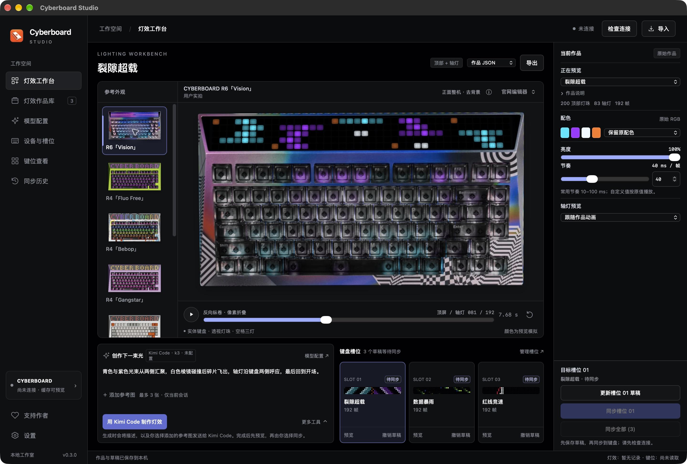
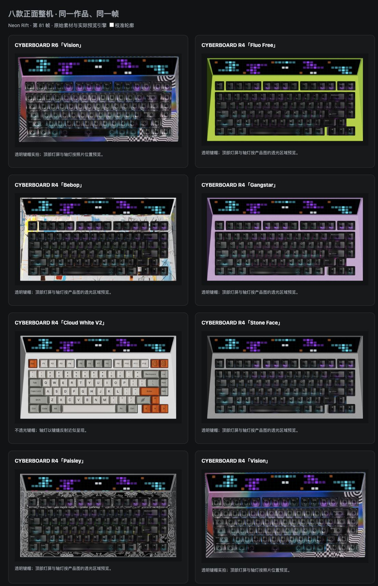
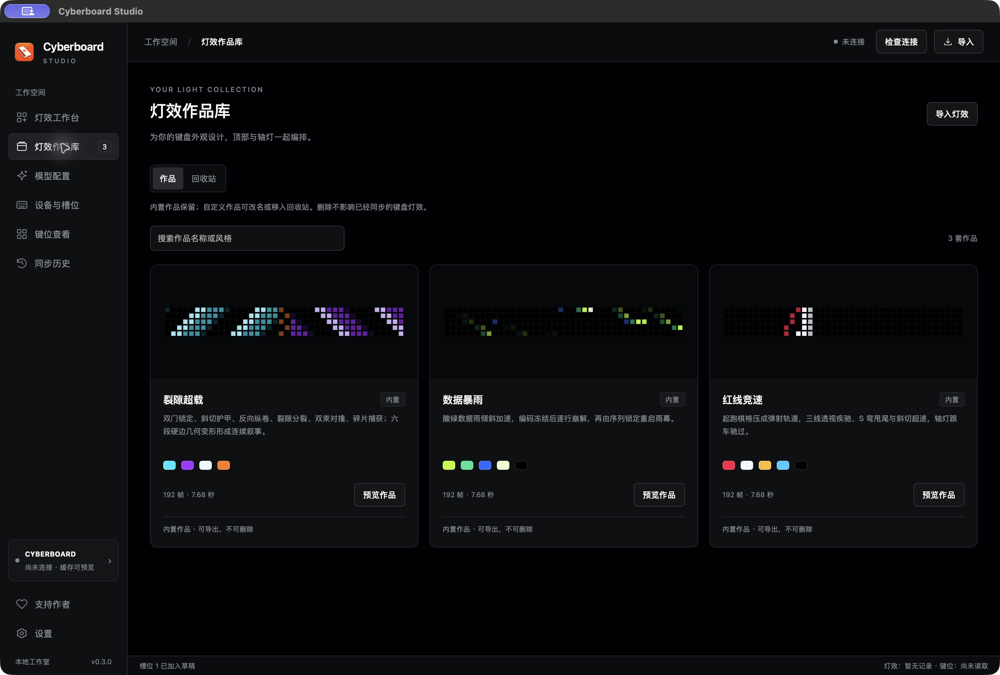

# Cyberboard Studio

[简体中文](README.md) · **English**

**A third-party desktop tool for Angry Miao CYBERBOARD R4 and CYBERBOARD R6 keyboards, available for macOS and Windows.**

Create animations for the top LED matrix and per-key backlighting with Kimi, MiniMax or DeepSeek. Start with a prompt and optional reference images, preview your design on real keyboard photos, then sync it to the keyboard through the bundled CLI.

[Download & release notes](https://github.com/maestrokaka/cyberboard-studio/releases) · [Full user guide — Chinese](docs/USER_GUIDE.md) · [Report an issue](https://github.com/maestrokaka/cyberboard-studio/issues) · [Support the author](#support-the-author)

This README is in English. The desktop app interface and full user guide are currently in Chinese; the quick start below includes the Chinese button labels to help you follow along.

## See it in action

A 77-second walkthrough: switch keyboard appearances and lighting effects, create a new design with Kimi `k3` and a reference image, then sync it to slot 03. Generation and transfer waits are sped up. The final scene shows the effect on a real CYBERBOARD R6. Recorded on macOS, with Chinese narration and captions.

https://github.com/user-attachments/assets/8289f982-09d3-45df-9ce7-5f7723c0da52

## Screenshots

These screenshots show the current macOS interface running in a separate demo workspace. Windows uses the same workbench interface. The appearance comparison uses the same preview engine, design and animation frame for every keyboard.

### Lighting workbench

AI creation stays on the workbench alongside the preview, lighting controls and three slot drafts. Click a keyboard thumbnail to change the appearance without changing your design or writing to the device.



### Model connections

Configure Kimi Code, Kimi Open Platform, MiniMax or DeepSeek, with separate provider, region, model and API key settings. Keys are hidden by default; use the Show / Hide button to view them. Keys are stored using the operating system's credential protection and are excluded from exported lighting JSON.


### Keyboard appearances

Eight appearances share a front view with the background removed:

| Model | Finish | Photo source |
| --- | --- | --- |
| CYBERBOARD R6 | Vision | User-provided photo |
| CYBERBOARD R4 | Fluo Free | Angry Miao official store |
| CYBERBOARD R4 | Bebop | Angry Miao official store |
| CYBERBOARD R4 | Gangstar | Angry Miao official store |
| CYBERBOARD R4 | Cloud White V2 | Angry Miao official store |
| CYBERBOARD R4 | Stone Face | Angry Miao official store |
| CYBERBOARD R4 | Paisley | Angry Miao official store |
| CYBERBOARD R4 | Vision | Angry Miao official product page |

The collection includes official photos of sold-out finishes. These are preview options, independent of current stock. [Photo sources](data/photos/official-photo-sources.json)



### Lighting library

Browse designs, palettes and loop lengths, or return to the workbench to preview them. Custom designs can be renamed, exported, moved to the trash and restored. Built-in designs remain available.



### Devices and configuration

Read the configuration JSON, choose the built-in modes you want to restore, review the changes and backup, then confirm synchronization. This screenshot shows the controls in a demo workspace with no keyboard connected.


## Download and install

The current release is [v0.3.0 Preview](https://github.com/maestrokaka/cyberboard-studio/releases/tag/v0.3.0). Find the packages and their SHA-256 files under **Assets**.

| Package | Platform | Installation |
| --- | --- | --- |
| `Cyberboard-Studio-0.3.0-macOS-AppleSilicon.zip` | Apple Silicon Mac, macOS 13 or later | Extract, move `Cyberboard Studio.app` to Applications, then open it. |
| `Cyberboard-Studio-0.3.0-Windows-x64.zip` | Windows 11 x64; eligible Windows 10 LTSC / Enterprise systems supported by the bundled .NET runtime | Extract the entire folder and open `Cyberboard Studio.exe`. Keep its DLLs and `resources` folder together. |
| `Cyberboard-Studio-0.3.0-Windows10-Compatibility-x64.zip` | Older Windows 10 x64 systems with a diagnosed CET startup compatibility error | Extract separately. This package removes the app's CET marker; the standard package keeps it. |

All packages include the CLI and its runtime. You do not need to install Python separately. If Windows is missing WebView2, run `Dependencies/MicrosoftEdgeWebview2Setup.exe` from the package with an internet connection.

Use the standard Windows package first. For a startup failure, run `诊断启动.cmd` to collect diagnostics; the compatibility package is intended for failures identified as CET-related. It does not change Windows security settings.

The Mac app uses an ad-hoc signature and is not yet signed with an Apple Developer ID or notarized. See [Apple's guidance on opening apps](https://support.apple.com/en-gb/102445) if macOS blocks it. An Intel Mac build is not currently available.

## Quick start

1. **Connect your keyboard by USB.** Use **Check connection（检查连接）** and verify the keyboard model before preparing a sync.
2. **Set up a model.** Open **Model configuration（模型配置）**, choose the service, region and model, enter your own API key, then click **Save and use（保存并使用）**. Kimi Code defaults to `k3`.
3. **Create a design.** Return to **Lighting workbench（灯效工作台）**. Describe the effect and optionally use **Add reference images（添加参考图）** to attach up to three images. Choose a model that supports images, then click the AI creation button. The button displays the selected provider.
4. **Preview and adjust.** Try different keyboard appearances, pause or scrub the animation, and adjust brightness and frame timing. To try another palette, choose a color scheme and use **More tools（更多工具） → Generate template variant（生成模板变体）** to create a new design. The preview simulates hardware colors; the physical keyboard may look different.
5. **Choose the destination.** Select slot **01**, **02** or **03**, then use **Place in slot（放入槽位）** or update that slot's draft. Clicking a slot card only selects the target; its separate **Preview（预览）** button previews the assigned design.
6. **Review and sync.** Click **Sync slot 03（同步槽位 03）**, or the equivalent button for your chosen slot. Review the plan and backup, then confirm **Sync to keyboard（同步到键盘）**. Keep USB connected until transfer and verification finish. Other pending slot drafts remain available.

Creating or previewing a design does not automatically write to the keyboard. You can create, preview and export lighting without a device connected.

Kimi Code and Kimi Open Platform use separate API keys and quotas. Code access is subject to the provider's client requirements; see the [official Kimi Code documentation](https://www.kimi.com/code/docs/).

### Existing configuration and first-time setup

The CLI cannot read LED animation pixels back from the keyboard. To preserve existing lighting and other slots, migrate a trusted complete CLI record from **the same keyboard**. The configuration view combines the last successfully saved local record with a fresh read of the device's current keymap.

If no trusted record exists, **Prepare first configuration（准备首次配置）** lets you review and explicitly initialize a replacement configuration. This cannot back up or recover unknown previous lighting. It preserves the 1,400 currently readable keycodes, but cannot preserve separate macro or key-swap tables; special key functions may need reconfiguration. Selected custom slots receive the chosen designs; unselected custom slots are disabled. The standard template enables battery, mosaic and clock modes, and disables text and flowing-light modes. This is a common template, not a readback of your keyboard's factory configuration.

To restore selected built-in modes, open **Devices and slots（设备与槽位）**, choose **Read configuration JSON（读取配置 JSON）**, select the modes, then **Prepare modification plan（准备修改计划）**. Review the changes and backup before confirming. Other modes, custom slots, current keycodes and local slot drafts are preserved.

A single-slot sync changes only the selected slot's lighting within a merged full configuration. Before writing, the app checks device identity and current keycodes; after the device acknowledges the transfer, it verifies all 1,400 keycodes. LED pixels are not read back for verification.

For record migration, first-time initialization and troubleshooting, see the [full guide in Chinese](docs/USER_GUIDE.md#baseline).

## Features and current scope

- AI creation from text and reference images, using separate top-matrix and backlight animation sequences.
- Kimi Code / Open Platform, MiniMax and DeepSeek connections. Image support depends on the selected model; text-only models cannot accept reference images.
- Eight front-view keyboard appearances, thumbnail selection, playback controls, palette variants, brightness and timing adjustments.
- A local design library, JSON import / export, custom names, trash and restore.
- Three slot drafts, synchronization of a chosen slot or all pending drafts, backups and local history.
- R4 / R6 identification, read-only inspection of 81 physical keys across seven layers, and clock synchronization. Clock synchronization currently uses **Asia/Shanghai (UTC+8)**.

Firmware updates, key remapping, general image generation and video export are not currently included.

On macOS, Kimi Code `k3` creation with a reference image and synchronization to R6 slot 03 have been tested on real hardware, including device acknowledgment and full keycode verification. The physical result appears in the demo.

The Windows packages are cross-compiled and pass offline checks. This release's Windows GUI, DPAPI credential storage and USB communication still need Windows hardware testing. Live MiniMax / DeepSeek generation, R4 writes, first-time initialization and built-in-mode restoration also await their respective account or hardware validation. Shared logic, model protocols, image handling, animation compilation and package contents have offline coverage.

## Local data

| Data | macOS | Windows |
| --- | --- | --- |
| Designs, drafts, trash, plans, backups and non-secret model settings | `~/Library/Application Support/Cyberboard Studio/` | `%LOCALAPPDATA%\Cyberboard Studio` |
| CLI device records | `~/.local/share/cyberboard-cli/devices/` | `%LOCALAPPDATA%\cyberboard-cli\devices` |

API keys use macOS Keychain or Windows user-level DPAPI protection. Reference images are kept only for the current session. Generation sends your prompt and selected images to the configured provider, without sending device configuration or keymaps.

## Building and contributing

The repository includes vendored `cyberboard-cli` 0.1.2 with R6 and cross-platform patches. See [CLI provenance and licenses](vendor/README.md).

Mac builds require Python 3.12, Node.js and Xcode Command Line Tools:

```sh
python3 scripts/setup-cli.py --env-dir .tools/macos-build --with-pyinstaller
.tools/macos-build/bin/python scripts/build-macos-backend.py
python3 scripts/prepare-data.py
native/build.sh --backend-dir build/macos-backend/CyberboardBackend
```

The resulting app is `build/Cyberboard Studio.app`. Windows builds use .NET 10 SDK; see the [Windows runtime build notes](windows/runtime-readme.txt) and [package build instructions in Chinese](README.md#从源码构建).

Tests use synthetic device configurations and HTTP substitutes. They do not access USB or consume model credits. See the [offline checks](README.md#离线验证). Personal device records, credentials, backups and workspace data must stay out of commits and release packages.

For bugs or suggestions, [open an issue](https://github.com/maestrokaka/cyberboard-studio/issues) with your app version, operating system, keyboard model and steps to reproduce the problem.

---

## Support the author

**Your keyboard is glowing. My coffee cup could use a refill. ☕**

If Cyberboard Studio helped bring your keyboard to life, you're welcome to buy **Kakà** a coffee and fuel the next lighting idea. Any amount is appreciated. Support is optional and does not affect access to features.

<p align="center">
  <a href="docs/assets/wechat-support.svg"></a>
  <br />
  <strong>Scan with WeChat · Kakà</strong>
</p>

For questions and suggestions, email [maestrokaka@gmail.com](mailto:maestrokaka@gmail.com). Please use email or GitHub Issues for feedback rather than payment messages.

**Would you like an English-language version of the app? Please contact me at [maestrokaka@gmail.com](mailto:maestrokaka@gmail.com).**
