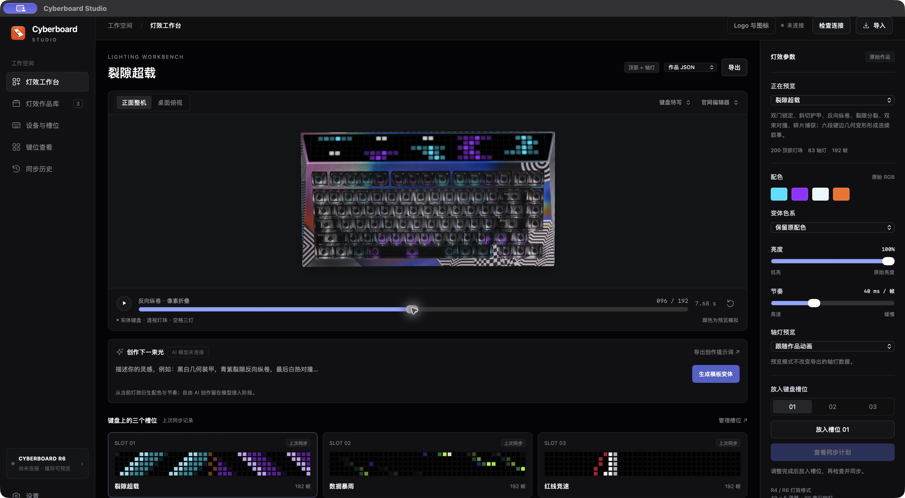
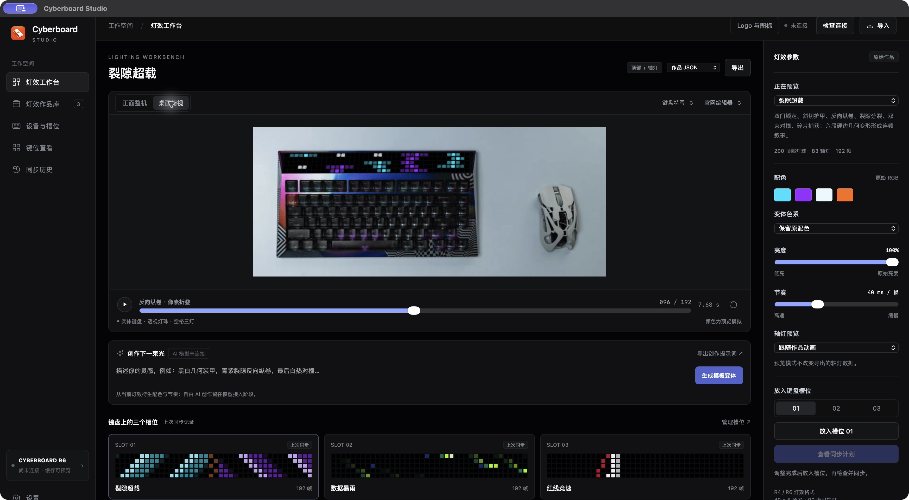
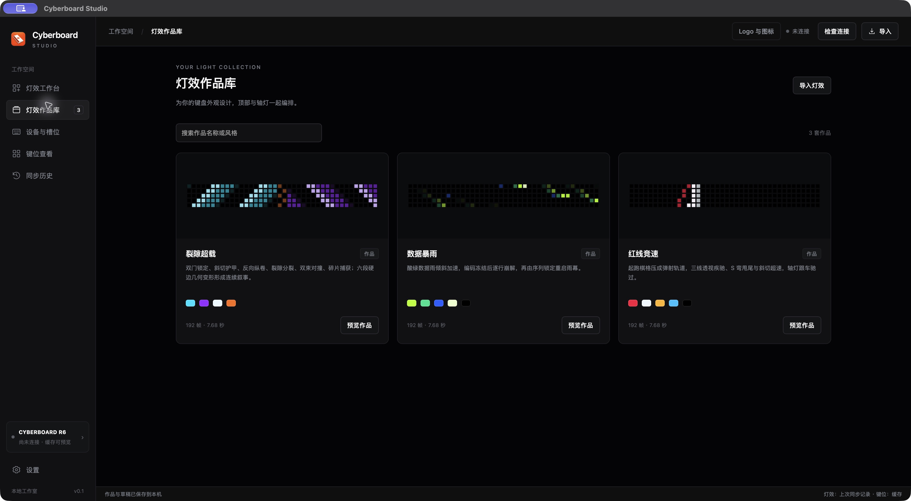

# Cyberboard Studio

Cyberboard 的 macOS / Windows 灯效工作台：设计顶部与轴灯动画，在真实键盘照片上预览，再通过本机 CLI 同步到键盘。

[下载软件与查看版本记录](https://github.com/maestrokaka/cyberboard-studio/releases)

## 应用截图

以下为 macOS 版实际运行截图，Windows 版共用同一套工作台界面。

### 灯效工作台

在去背景的真实键盘特写上预览顶部与轴灯动画，调整亮度、节奏与槽位草稿。



### 桌面整机预览

切换实体照片视角，查看灯效与键盘外观的整体搭配。



### 灯效作品库

浏览三套作品的像素缩略图、配色、动画帧数与循环时长，再进入工作台预览。



## 下载与运行

| 文件 | 适用电脑 | 打开方式 |
| --- | --- | --- |
| `Cyberboard-Studio-0.1.0-macOS-AppleSilicon.zip` | Apple Silicon Mac，macOS 13 及以上 | 解压，将 `Cyberboard Studio.app` 放入「应用程序」，双击打开 |
| `Cyberboard-Studio-0.1.0-Windows-x64.zip` | Windows 11 x64；部分受 .NET 10 支持的 Windows 10 LTSC/Enterprise | 完整解压，双击 `Cyberboard Studio.exe`，保留旁边的 DLL 和 `resources` |

两个发布包均带 CLI 和运行环境，无需自己安装 Python。Windows 缺少 WebView2 时，运行包内 `Dependencies/MicrosoftEdgeWebview2Setup.exe`，联网安装后重新打开应用。

当前是 `v0.1.0` 内测版。Mac 包为本机 ad-hoc 签名，尚未用 Apple Developer ID 签名或公证；系统可能提示无法验证开发者，可参照 [Apple 的应用打开说明](https://support.apple.com/en-gb/102445)。Intel Mac 尚未提供构建。Windows 版已交叉编译并通过离线检查，原生启动和真实 USB 通信尚待 Windows 实机验证。

仓库与已发布版本公开可访问，无需登录即可查看源码、截图和下载软件。

## 当前功能

- 裂隙超载、数据暴雨、红线竞速三套作品；顶部与轴灯独立帧序列。
- 真实键盘照片上的整机、特写、灯珠与轴灯预览；暂停、时间轴、亮度、节奏和配色变体。
- JSON 导入导出、作品库、草稿与三个灯效槽位。
- R4 / R6 设备身份检查、81 个实体键的 7 层键位读取、时间同步。
- 同步前创建完整配置备份和计划，用户确认后传输，检查设备确认及全部键码读回。
- 本地历史与恢复计划。

AI 服务尚未连接。可导出创作规格供外部 AI 使用、导入生成的 JSON，或使用本地模板变体。当前 CLI 不支持固件升级。

启动应用与播放预览不会自动探测或写入 USB。软件包不包含个人设备配置、键位读取记录或历史。

## 第一次同步

灯效像素不能从键盘读回，软件必须有这把键盘此前成功写入后保存的完整 CLI 记录，才能保留其他槽位。普通「导入灯效」仅添加作品，不建立设备基线。

- 在原 Mac 上，记录通常位于 `~/.local/share/cyberboard-cli/devices/AM01R6/`；R4 使用自己的产品 ID。保留 `current.json` 和 `meta.json`，不要改写身份。
- 在同一台 Mac 上，发布版沿用原 CLI 设备记录，可以直接检查连接并准备同步。
- 移到 Windows 时，关闭 App，双击包内「迁移原配置.cmd」，粘贴原设备目录或 `current.json` 的完整路径。工具校验结构与 CRC，拒绝覆盖已有记录，不操作 USB。详细步骤见 [Windows 使用说明](windows/release-readme.txt)。
- 在另一台 Mac 上，将可信记录复制至对应 CLI 设备目录，关闭 App 后复制，随后重新打开。

连接后先检查设备身份与键位，再查看同步计划；确认写入后保持 USB 连接，等待提交和验证完成。

## 本机数据

| 数据 | macOS | Windows |
| --- | --- | --- |
| 作品、草稿、计划、备份 | `~/Library/Application Support/Cyberboard Studio/` | `%LOCALAPPDATA%\Cyberboard Studio` |
| CLI 设备记录 | `~/.local/share/cyberboard-cli/devices/` | `%LOCALAPPDATA%\cyberboard-cli\devices` |

`CYBERBOARD_DATA_DIR` 可显式指定 CLI 记录目录。用户数据与应用安装目录分开保存。

## 从源码构建

需要 Python 3.12、Node.js；Mac 构建还需 Xcode Command Line Tools，Windows 构建还需 .NET 10 SDK。

本仓库保留经过验证的 CLI 0.1.2 源码、R6 识别与跨平台补丁，见 [CLI 来源与许可证](vendor/README.md)。源码素材在 `data/`，测试使用合成配置，不能将其当作真实设备基线。

Mac，在仓库根目录执行：

```sh
python3 scripts/setup-cli.py --env-dir .tools/macos-build --with-pyinstaller
.tools/macos-build/bin/python scripts/build-macos-backend.py
python3 scripts/prepare-data.py
native/build.sh --backend-dir build/macos-backend/CyberboardBackend
```

这会先冻结独立后台，再生成 `build/Cyberboard Studio.app`。Mac 构建会检查发布素材不含个人基线，并验证签名。

Windows 独立运行环境准备与校验见 [运行环境构建说明](windows/runtime-readme.txt)。准备 `windows/runtime/python` 后：

```sh
python windows/build.py --dotnet /path/to/dotnet --nuget /path/to/nuget-cache --bootstrapper /path/to/MicrosoftEdgeWebview2Setup.exe
```

`--dotnet`、`--nuget` 可省略以使用本机 SDK 与仓库内缓存；软件包始终包含完整运行组件。Windows 使用 `EnableWindowsTargeting`，允许从 Mac 交叉编译。WebView2 引导安装器来自 [Microsoft 官方下载](https://go.microsoft.com/fwlink/p/?LinkId=2124703)。

## 离线验证

```sh
node tests/model-check.cjs
node tests/renderer-check.cjs
node tests/ui-check.cjs
STUDIO_UI_PLATFORM=windows node tests/ui-check.cjs
.tools/macos-build/bin/python tests/backend-check.py
.tools/macos-build/bin/python windows/tests/migration-check.py
```

测试使用设备替身，不访问 USB。发布包另外检查依赖校验和、架构、许可证、无个人状态，以及 Mac 后台整体搬移后的运行能力。

## 代码结构

- `web/`：灯效工作台、JSON 模型、照片预览和已确认的 Logo。
- `backend/bridge.py`：CLI 桥接、备份、同步计划、实际传输与验证。
- `native/`：macOS 窗口、原生文件对话框、后台通信与同步保护。
- `windows/src/`：WinForms / WebView2 窗口、文件对话框和后台进度。
- `windows/runtime/`：Windows 运行环境的官方来源、固定版本和准备脚本。
- `vendor/`：CLI 源码、补丁说明及第三方许可。
- `data/`：灯效作品、照片校准、通用实体布局与合成测试 fixture。
- `scripts/`：环境准备、素材生成和 Mac 后台构建。

## 在 GitHub 更新

改好的代码提交并推送到 `main`。可下载软件放在 Releases，使用新的版本号保存更新说明、macOS / Windows 软件包及校验文件；无需把编译缓存或运行库加入 Git 历史。[GitHub Releases 说明](https://docs.github.com/en/repositories/releasing-projects-on-github/about-releases)
