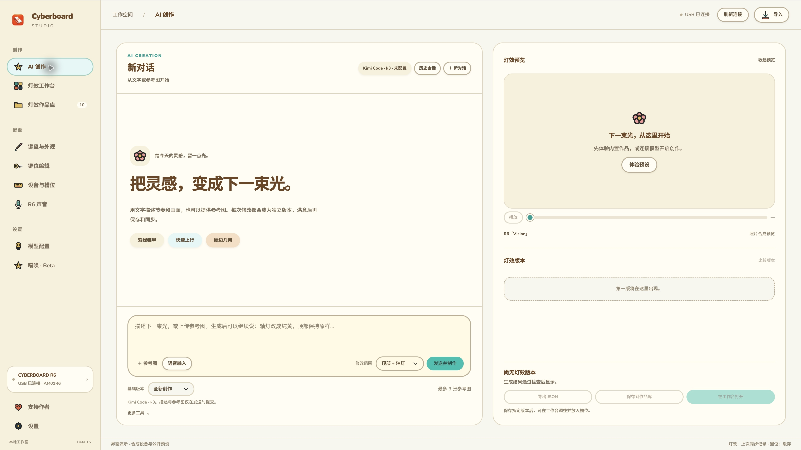
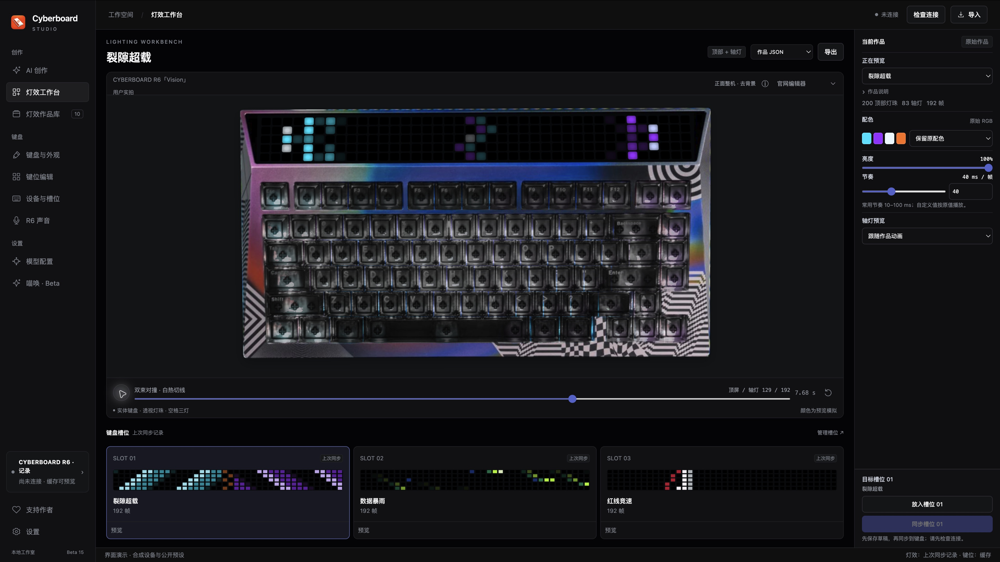
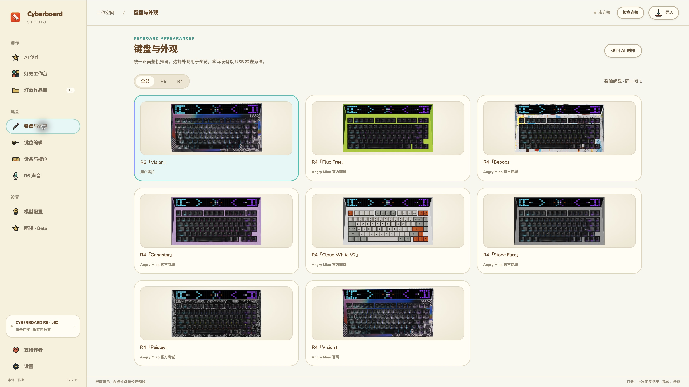
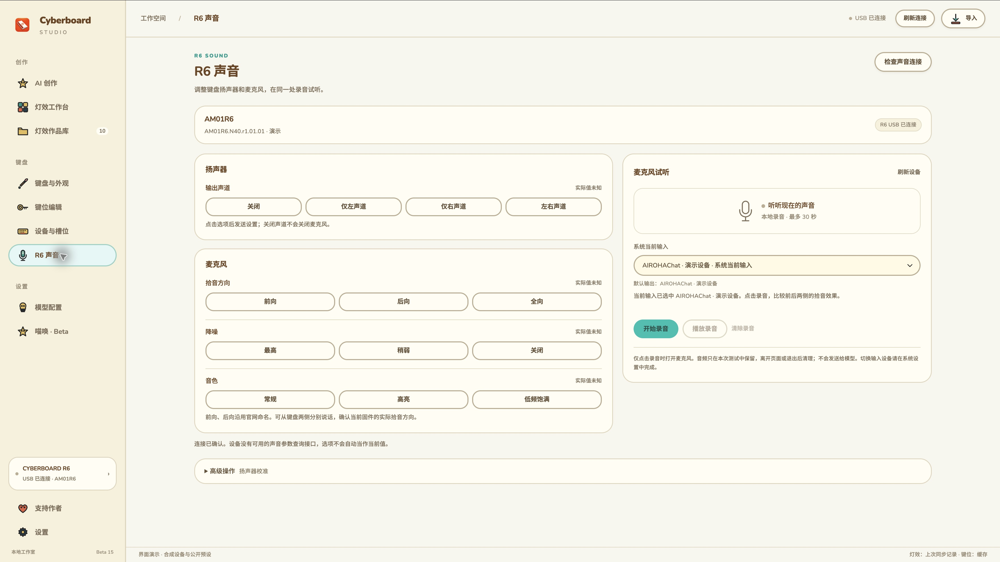
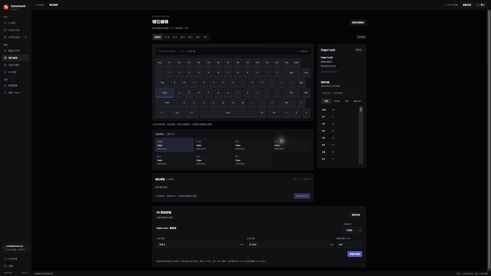
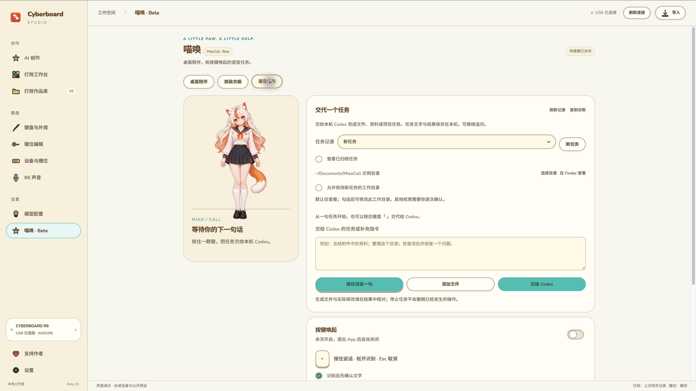

# Cyberboard Studio · 下一版预告

**简体中文** · [English](README.en.md)

面向 **CYBERBOARD R4 / R6** 的第三方键盘工作室：用 AI 对话创作灯效，在真实键盘照片上比较版本，再调整并同步到键盘。实验性的「喵唤」让你按住一颗键，把任务交给本机 Codex；R6 新增独立声音设置、麦克风试听和高级键位编辑。

**App 暂不公开发布** · [本版更新说明](docs/RELEASE_NOTES_BETA15.md) · [R6 配置指南](docs/R6_CONFIGURATION.md) · [反馈问题](https://github.com/maestrokaka/cyberboard-studio/issues)

这是 **下一版本的功能预告**。公开仓库同步源码、说明和截图，App 安装包暂不公开提供；历史 Beta 14、RC2 与 0.4.x 保留。本次在私有测试中整合通用 Codex 任务、桌面陪伴、Windows 接入和 R6 配置能力，新增硬件功能仍需实机验收。

当前源码包含 **Beta 15.1** 修订，修复 Windows 取消后台请求时偶发误报“没有返回结果”的问题。以下截图展示正在测试的 Beta 15 系列界面，不代表已经公开发行。

## Beta 15 新增与修正

- **同步状态更清楚**：区分已发送、设备已确认、键位已验证与状态未知。可能改写设备后失败或中断，会阻止继续复用旧灯效基线；不会盲目重复整包写入。
- **独立「R6 声音」页**：设置扬声器声道、麦克风方向、降噪和音色。采用独立短指令；打开页面和检查连接只做查询，不自动设置参数。没有可用的声音当前值查询接口时显示未知，设置回执不会冒充声学验证。
- **本地麦克风试听**：列出系统输入与默认输出，明确当前系统默认输入。主动录制最长 30 秒，再本地回放、清除；离页清理，不发送给语音模型。高级区提供需单独确认的扬声器校准。
- **R6 单键、长短按与宏**：独立指令与配置表，支持新增、更新、删除及删除后的普通绑定；读取完整基底、审核修改并生成备份后才写入。发送后核对完整键码及可读高级表。未读全的表不会当作空表覆盖。
- **Codex 通用持久任务**：选择工作目录、添加文件、交代任务、继续追问、执行中补充、逐次授权并查看结果与文件。Spotify 只是可选 Mac 示例。
- **Windows 快速连接 Codex**：安装 → 登录 → 检测连接，采用官方原生 CLI，无需先装 Node.js 或 WSL，不读取或复制认证文件。
- **更多桌面陪伴**：常驻 / 仅唤醒、拖动记位置、三套服装和长发选项、32 张姿势、15 个互动区域、四种离线声线。声音默认关闭；AI 换装先预览再应用。
- **固件更新入口**：显示版本并交接到 Angry Miao 官方网页完成升级。本版没有在 App 内刷写固件；局部灯效协议仍待实机验证，未默认启用。

## 灯效工作室

- **AI 创作**：接入 Kimi、MiniMax 或 DeepSeek，用文字和最多 3 张参考图创作；保存会话、独立版本与局部修改。
- **灯效工作台**：整机照片预览、亮度 / 节奏 / 配色调整、三槽草稿与同步前审核。内置 10 款可删除灯效，无需模型 Key 即可体验。
- **键盘与外观**：8 款 R4 / R6 正面外观，同作品、同一帧比较；页面先显示，预览按可取消的小批次准备。
- **双风格界面**：经典深色与暖岛浅色即时切换，重开保留；不改变作品 RGB 或槽位。
- **可读键位与语音输入**：81 个实体键、7 层中文功能；AI 输入框单独配置 MiniMax、千问或 OpenAI 语音识别，识别后检查文字再发送。

## B 站横版演示 · Beta 14

约 **3 分 7 秒**，展示 AI 创作灯效和按键唤起喵娘的基本流程。视频沿用 Beta 14 的界面与功能范围，Beta 15 新增能力见下方截图和更新说明。

https://github.com/user-attachments/assets/a0ea2c61-1c65-4d93-a893-b44f2995d499

可直接在上方播放器观看 720p 压缩预览，不提供原画质下载或工程素材。灯效为照片合成预览；喵唤部分为流程示意。Releases 不附视频。

## 界面预览

| AI 创作 · 暖岛浅色 | 灯效工作台 · 经典深色 |
| --- | --- |
|  |  |
| **键盘与外观** | **R6 声音与麦克风试听** |
|  |  |
| **R6 键位编辑** | **喵唤与桌面陪伴** |
|  |  |

截图来自独立演示环境，不含个人 Key、会话或设备记录。照片合成灯效不是实机色准测量，示例状态也不代表真实设备已经写入。

## 公开预告与测试状态

本轮公开仓库仅提供源码、功能说明和截图，**暂不发布 App 安装包**。刚上传的 Beta 15 已撤下；此前 Beta 14、RC2 和 0.4.x 历史发行版保留。

macOS Apple Silicon、Windows x64 与 Windows 10 Compatibility 在私有测试中验证。Mac 使用 ad-hoc 签名，尚未进行 Developer ID 签名或公证；新增 R6 声音、宏和长短按仍需实机确认。局部灯效写入未启用，固件升级交接到官方网页。

## 五分钟开始创作

1. 打开「灯效工作台」，先预览内置作品，无需 Key。
2. 在「模型配置」选择 Kimi、MiniMax 或 DeepSeek，保存有权限的 Key。
3. 进入「AI 创作」，描述画面或上传参考图，例如「橙红火焰从底部窜起，轴灯像余烬，4 秒循环」。
4. 选择明确的基础版本和范围继续修改，例如「仅轴灯改成纯黄，顶部保持原样」。
5. 保存指定版本，放入槽位草稿，检查连接与同步计划，再确认写入。

文字和参考图仅在点击制作时提交给所选服务。Key 按服务保存在普通本机文件，默认隐藏，可直接显示；不读取、解密或迁移旧 Keychain / DPAPI 记录。

## 喵唤：交代任务给 Codex

1. 安装并登录本机 Codex，进入「喵唤 · Beta」→「语音任务」。Windows 可直接使用「安装 → 登录 → 检测连接」。
2. 选择任务工作目录，必要时添加文件。新任务默认只读，需要修改时明确开启写入。
3. 输入任务并提交；或先配置语音识别服务，按住「·」说话，检查识别文字后提交。
4. 查看步骤、回答问题或逐次授权，核对结果和文件。同一个任务可继续追问，执行中可补充指令。

通过官方本机 app-server 创建和续接喵唤自己的持久会话，实际能力取决于本机 Codex 工具与权限；不接管其他桌面聊天。Codex 登录与语音识别是两条连接，文字任务无需语音 Key。WorkBuddy、千问办公和豆包工作仍为规划入口。

快捷键默认关闭，关闭时正常输入符号，退出时释放。桌面喵娘可独立常驻，不自动录音；录音、转写和任务期间暂停闲聊。四种离线声线默认静音，AI 衣装生成仅在主动点击时发送角色参考与服装描述，先预览再应用。当前 AI 衣装为单张立绘，不自动生成完整动作集。[任务使用说明](docs/MIAOCALL_TASKS.md) · [陪伴与衣橱说明](docs/MIAOCALL_COMPANION.md)

## 内置灯效 GIF


我已经借助 AI 创作并打磨了 **10 款灯效**，全部内置到软件中。无需配置模型，打开就能预览，选好后即可同步到键盘。

想做自己的灯效，也可以接入 **Kimi、MiniMax 或 DeepSeek**，写下你的想法，让 AI 帮你创作。

有想要的主题、角色或灯效，欢迎[到 GitHub Issues 留言告诉我](https://github.com/maestrokaka/cyberboard-studio/issues)。附上一句话描述或参考图，下一款内置灯效，也许就来自你的脑洞。

下方是这 10 款灯效的整机动态预览，点击动图可查看大图。

| 预设 | 预设 |
| --- | --- |
| **01 裂隙超载**<br>青紫装甲与裂隙转场 · 7.68 秒<br><a href="docs/previews/neon-rift.gif"></a> | **02 数据暴雨**<br>绿色数据光点与落雨 · 7.68 秒<br><a href="docs/previews/data-storm.gif"></a> |
| **03 红线竞速**<br>红白轨迹与速度感 · 7.68 秒<br><a href="docs/previews/redline-rush.gif"></a> | **04 EVA初号机 · 觉醒序列**<br>紫绿装甲、眼部与觉醒阶段 · 4.8 秒<br><a href="docs/previews/eva-awakening.gif"></a> |
| **05 故障字标 · 终端夺权**<br>宽幅赛博字标与错位转场 · 4.8 秒<br><a href="docs/previews/glitch-override.gif"></a> | **06 马里奥 · 红帽闯关**<br>纯红帽子与像素闯关 · 4.2 秒<br><a href="docs/previews/mario-run.gif"></a> |
| **07 猫逐萤火**<br>小猫与萤火追逐 · 6 秒<br><a href="docs/previews/cat-firefly.gif"></a> | **08 卡卡 · 红黑22**<br>球星卡、肖像与姓名号码 · 4.8 秒<br><a href="docs/previews/kaka-rossonero.gif"></a> |
| **09 卡卡 · 极速突破**<br>带球动作与清楚的 KAKA 22 · 4.8 秒<br><a href="docs/previews/kaka-breakaway.gif"></a> | **10 卡卡 · 圣西罗之夜**<br>庆祝姿态与红白旗浪 · 4.8 秒<br><a href="docs/previews/kaka-san-siro.gif"></a> |

<details>
<summary>关于动图预览</summary>

动图采用 CYBERBOARD R6「Vision」去背景正面实拍照片，与 App 共用预览渲染器，合成顶部与轴灯的完整原速动画。源作品 RGB 与节奏不变；GIF 编码可能产生轻微色差，照片合成预览不代表实机色准。[GIF 校验记录](docs/previews/manifest.json) · [三款卡卡的优化过程](docs/LIGHTING_DESIGN_NOTES.md)

</details>

## 数据与验证范围

个人作品、会话、参考图、槽位草稿、Key、任务及设备记录与安装目录分开保存，不进入源码或安装包。AI／喵唤语音录音最长 60 秒，R6 本地试听最长 30 秒，只在明确操作后采集并清理，不保存到作品和工作区。同步灯效、改键、声音设置和校准都有明确操作入口，不会因切换外观或升级 App 自动执行。

本版检查覆盖设备协议替身、异常/中断状态、完整键位与高级表核对、声音回执与录音生命周期、两种主题、照片预览比例及实际软件包。离线和 CI 通过不能替代真实硬件验收：R6 声音参数与物理方向、麦克风录放、新增宏/长短按、局部灯效、Windows 原生 GUI / 快捷键 / 用户登录和 USB，仍需对应实机确认。[验收边界与操作说明](docs/R6_CONFIGURATION.md#验证范围)

此前 Windows 原生 CI 已通过宿主构建、所属子进程回收、官方 Codex 安装与自动发现、真实 app-server 初始化和未登录状态查询；没有把这些检查描述为用户已登录并完成真实任务。Beta 14 的预览性能、照片遮罩与语音 TLS 依赖修复继续保留。

## 从源码构建

需要 Python 3.12、Node.js；Mac 还需 Xcode Command Line Tools，Windows 还需 .NET 10 SDK。本仓库保留经过补丁维护的 CLI 0.1.2，见 [来源与许可证](vendor/README.md)。测试配置只能用于替身验证，不是真实设备基线。

Mac，在仓库根目录执行：

```sh
python3 scripts/setup-cli.py --env-dir .tools/macos-build --with-pyinstaller
.tools/macos-build/bin/python scripts/build-macos-backend.py
python3 scripts/prepare-data.py
native/build.sh --backend-dir build/macos-backend/CyberboardBackend
```

Windows 运行环境准备见 [构建说明](windows/runtime-readme.txt)。准备 `windows/runtime/python` 后执行：

```sh
python windows/build.py --dotnet /path/to/dotnet --nuget /path/to/nuget-cache --bootstrapper /path/to/MicrosoftEdgeWebview2Setup.exe
```

`--dotnet`、`--nuget` 可省略以使用本机 SDK 与缓存。构建始终包含运行组件，WebView2 引导安装器来自 Microsoft 官方。可用 `python scripts/check-release.py --mac-native` 运行本机发布检查；具体前端、后端及软件包检查位于 `tests/`。测试使用合成设备和 HTTP 替身，不访问 USB 或消耗模型额度。

源码主要位于 `web/`、`backend/`、`native/`、`windows/src/`；公开作品、照片与通用布局在 `data/`，CLI 与第三方许可在 `vendor/`。本版的 R6 协议根据官网公开通信行为独立实现，没有搬运整站业务代码。

## 发布维护

本轮公开仓库只同步预告源码、文档与截图；App 包仅私有测试。刚公开的 Beta 15 已撤下，历史 Beta 14、RC2 和 0.4.x 标签/附件保留原样。Releases 不放视频、私人录音、声纹源素材、Key、个人工作区或设备记录。反馈时请附 App 版本、系统、键盘型号、固件版本和复现步骤，到 [Issues](https://github.com/maestrokaka/cyberboard-studio/issues) 留言。

## 支持作者


**键盘已经亮了，咖啡杯还空着。☕**

如果 Cyberboard Studio 帮你点亮了喜欢的灯效，欢迎请 **Kakà** 喝杯咖啡，给下一次灵感补一点咖啡因。金额随心，心意满格；支持完全自愿，不影响任何功能的使用。

<p align="center">
  <a href="docs/assets/wechat-support.svg"></a>
  <br />
  <strong>微信扫一扫 · Kakà</strong>
  <br />
  <sub>点击二维码可查看大图</sub>
</p>

有 Bug、有脑洞，或者想聊聊你的键盘，欢迎写信给 [maestrokaka@gmail.com](mailto:maestrokaka@gmail.com)。

**咖啡可以扫码，问题请走邮件。** 付款留言不方便跟进，别让你的好点子迷路了。

如果你需要英文界面的 App，欢迎联系我：[maestrokaka@gmail.com](mailto:maestrokaka@gmail.com)。
