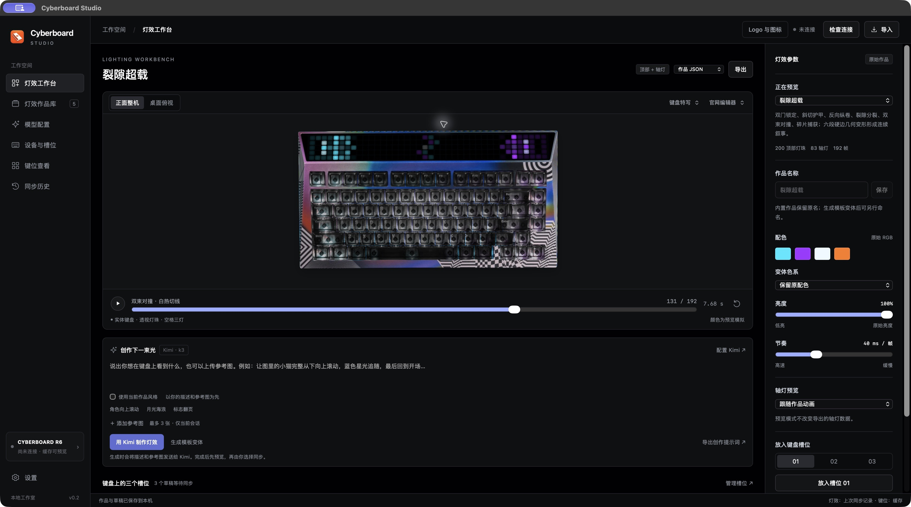
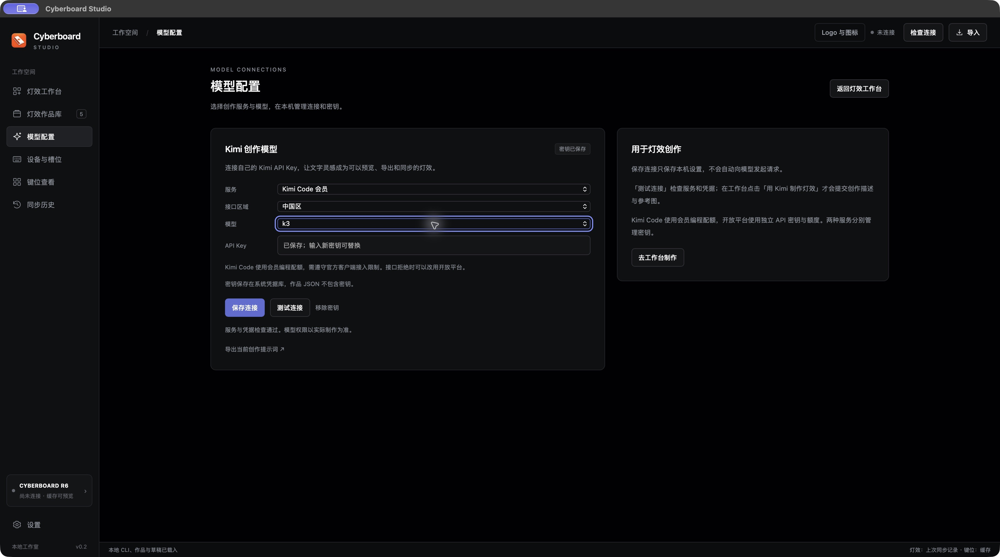

# Cyberboard Studio

**第三方怒喵（Angry Miao）键盘工具，支持 CYBERBOARD R4 / CYBERBOARD R6，适用于 macOS / Windows。**

用 Kimi 和参考图制作顶部与轴灯动画，在真实键盘照片上预览，再通过本机 CLI 同步到键盘。

[下载软件与查看版本记录](https://github.com/maestrokaka/cyberboard-studio/releases) · **[完整使用说明](docs/USER_GUIDE.md)** · [反馈问题](https://github.com/maestrokaka/cyberboard-studio/issues) · [支持作者](#支持作者)

第一次使用可先阅读[五分钟上手](docs/USER_GUIDE.md#quick-start)，查看安装、Kimi 连接、文字与参考图创作、预览、JSON、原配置迁移、同步、键位、时间和故障处理的完整步骤。

## 应用截图

以下为 macOS 版实际运行截图，Windows 版共用同一套工作台界面。

### 灯效工作台

在去背景的真实键盘特写上预览顶部与轴灯动画，调整亮度、节奏与槽位草稿。



### 模型配置

左侧「模型配置」与灯效工作台并列，集中管理服务、区域、模型和密钥。默认使用 Kimi Code 的 `k3`，也可切换其他 Code 模型或 Kimi 开放平台。密钥保存在系统凭据库，工作台与作品 JSON 不包含密钥。



### 桌面整机预览

切换实体照片视角，查看灯效与键盘外观的整体搭配。


### 灯效作品库

浏览作品的像素缩略图、配色、动画帧数与循环时长，进入工作台预览；自定义作品支持命名、移入回收站和恢复。


## 下载与运行

| 文件 | 适用电脑 | 打开方式 |
| --- | --- | --- |
| `Cyberboard-Studio-0.2.2-macOS-AppleSilicon.zip` | Apple Silicon Mac，macOS 13 及以上 | 解压，将 `Cyberboard Studio.app` 放入「应用程序」，双击打开 |
| `Cyberboard-Studio-0.2.2-Windows-x64.zip` | Windows 11 x64；部分受 .NET 10 支持的 Windows 10 LTSC/Enterprise | 完整解压，双击 `Cyberboard Studio.exe`，保留旁边的 DLL 和 `resources` |

两个发布包均带 CLI 和运行环境，无需自己安装 Python。Windows 缺少 WebView2 时，运行包内 `Dependencies/MicrosoftEdgeWebview2Setup.exe`，联网安装后重新打开应用。

当前是 `v0.2.2` 内测版；[v0.2.1](https://github.com/maestrokaka/cyberboard-studio/releases/tag/v0.2.1)、[v0.2.0](https://github.com/maestrokaka/cyberboard-studio/releases/tag/v0.2.0) 与 [v0.1.0](https://github.com/maestrokaka/cyberboard-studio/releases/tag/v0.1.0) 保留作为历史版本。Mac 包为本机 ad-hoc 签名，尚未用 Apple Developer ID 签名或公证；系统可能提示无法验证开发者，可参照 [Apple 的应用打开说明](https://support.apple.com/en-gb/102445)。Intel Mac 尚未提供构建。Windows 版已交叉编译并通过离线检查，原生启动、系统密钥保护和真实 USB 通信尚待 Windows 实机验证。

仓库与已发布版本公开可访问，无需登录即可查看源码、截图和下载软件。

v0.2.2 改善工作台的独立滚动和固定槽位操作区，修复导入校验、槽位草稿恢复、历史恢复与同步结果提示；参考图片先转换为 sRGB。[本次更新说明](https://github.com/maestrokaka/cyberboard-studio/releases/tag/v0.2.2)

## 当前功能

- Kimi 文字 / 参考图创作：最多 3 张图片，生成顶部与轴灯新动画，校验后自动入库预览。
- Kimi Code / 开放平台连接、服务测试、macOS 钥匙串与 Windows 用户级密钥保护。
- 独立「模型配置」页面，Code 四种官方模型可选；文字、参考图与可选的当前作品风格共同编排。
- 裂隙超载、数据暴雨、红线竞速三套作品；顶部与轴灯独立帧序列。
- 真实键盘照片上的整机、特写、灯珠与轴灯预览；暂停、时间轴、亮度、节奏和配色变体。
- 作品命名、按显示名称导出 JSON、作品库与回收站、草稿和三个灯效槽位。
- R4 / R6 设备身份检查、81 个实体键的 7 层键位读取、时间同步。
- 同步前创建完整配置备份和计划，用户确认后传输，检查设备确认及全部键码读回。
- 灯效计划读取并保留设备当前完整键位；本机旧记录提供灯效和其他槽位，不用旧键码覆盖现有按键。
- 单独同步当前 `01 / 02 / 03` 槽位，或明确同步全部待同步草稿；单槽完成后保留其他草稿。
- 本地历史与恢复计划。

v0.2.0 已接入 Kimi，同时保留本地模板变体、外部 AI 创作规格导出与作品 JSON 导入。当前 CLI 不支持固件升级。

v0.2.1 将创作提示词扩展为 12 类设计方向与 8 种运动语言，按主题选择角色微动作、渐变、自然、文字、游戏或光轨等组合，不套用固定场景模板。内部 Kimi 输出有界配方，由本地编译完整帧；外部提示词要求完整 Studio 作品 JSON。顶部每帧 200 色、轴灯每帧 90 色，不能把顶部数组复制成轴灯。App 当前仍请求 192 帧和当前 `10–100 ms / 帧`，3–8 秒只是设计目标。[提示词与格式说明](docs/USER_GUIDE.md#creative)

在左侧「模型配置」选择服务、区域和模型，输入自己的 API Key 并保存；回到工作台填写描述或添加参考图，点击「用 Kimi 制作灯效」。默认优先遵循描述和图片，当前作品只提供配色建议；需要参考当前作品的主题和风格时，再勾选「使用当前作品风格」。图片只保留在当前会话，不发送设备配置、键位或整份草稿。生成不会自动放入槽位或写入 USB。完整步骤见[AI 创作说明](docs/USER_GUIDE.md#creative)。

默认 Code 模型为 `k3`，下拉可选择 `k3`、`k3-256k`、`kimi-for-coding` 或 `kimi-for-coding-highspeed`；开放平台默认 `kimi-k3`。两种服务都可选择「自定义模型…」填写有权限使用的官方模型 ID，使用不同密钥和额度；当前实际支持这两种 Kimi 服务，独立配置页面为后续服务扩展保留空间。[Kimi 模型配置](https://www.kimi.com/code/docs/kimi-code/models.html)

AI 根据素材设计图案和时间轴：五行能辨认的角色适合少而精的眨眼、摆动等微动作；需要完整高造型时，可用最多 40×32 的像素图按需滚动。不会把整张高图强制压扁成五行、要求所有角色滚动，或执行模型返回的代码。

macOS 已实际验证 Code 密钥保存、连接检查及 `kimi-for-coding` 在线生成；新默认 `k3` 尚未单独完成真实生成验证。协议、图片处理、动画编译和交互另有离线检查。新版同步流程的读取与计划准备不代表实际写入成功，真实写入及完成后读回仍待验收；Windows 原生启动、DPAPI 和真实 USB 也待实机验证。Kimi 官方将 Code 会员接口用于编程工具，产品集成推荐开放平台；本 App 保持真实客户端身份，实际权限与可用性以平台为准。[Kimi 官方接入说明](https://www.kimi.com/code/docs/)

启动应用与播放预览不会自动调用模型、探测或写入 USB。软件包不包含个人设备配置、键位读取记录或历史。

## 第一次同步

灯效像素不能从键盘读回，软件必须有这把键盘此前成功写入后保存的完整 CLI 记录，才能保留其他槽位。准备计划时重新读取当前设备的全部键位，用它们合并目标灯效；旧记录的键码与当前不同，不需要为了改灯效重置按键。普通「导入灯效」仅添加作品，不建立设备基线。

- 在原 Mac 上，记录通常位于 `~/.local/share/cyberboard-cli/devices/AM01R6/`；R4 使用自己的产品 ID。保留 `current.json` 和 `meta.json`，不要改写身份。
- 在同一台 Mac 上，发布版沿用原 CLI 设备记录，可以直接检查连接并准备同步。
- 移到 Windows 时，关闭 App，双击包内「迁移原配置.cmd」，粘贴原设备目录或 `current.json` 的完整路径。工具校验结构与 CRC，拒绝覆盖已有记录，不操作 USB。详细步骤见[完整使用说明：首次同步](docs/USER_GUIDE.md#baseline)与 [Windows 包内说明](windows/release-readme.txt)。
- 在另一台 Mac 上，将可信记录复制至对应 CLI 设备目录，关闭 App 后复制，随后重新打开。

连接后先检查设备身份与键位，将作品放入目标草稿，再点「仅同步槽位 0N」查看单槽计划；一起修改多个槽位时使用「同步全部草稿 (N)」。确认写入后保持 USB 连接，等待提交和验证完成。

「刷新连接」只更新读取结果，不把键位写回设备或改写本机 `current.json`。新版计划分别保留原记录与当前键位的来源，显示差异和本次按键重映射为零；执行前会重新检查。升级前准备的旧计划需要关闭后重新准备。只有设备确认及全部 1,400 个键码读回一致，才把成功目标记录为当前配置。灯效仍来自上次写入记录，不能通过刷新恢复实际 LED 像素。

没有可信原记录的新用户可先预览、导出作品、读取键位和同步时间；当前 GUI 不能从键盘读回灯效并初始化完整记录。具体限制与首次建立记录的区别见[使用说明](docs/USER_GUIDE.md#baseline)。

## 本机数据

| 数据 | macOS | Windows |
| --- | --- | --- |
| 作品、回收站、草稿、计划、备份、无密钥连接设置 | `~/Library/Application Support/Cyberboard Studio/` | `%LOCALAPPDATA%\Cyberboard Studio` |
| CLI 设备记录 | `~/.local/share/cyberboard-cli/devices/` | `%LOCALAPPDATA%\cyberboard-cli\devices` |

`CYBERBOARD_DATA_DIR` 可显式指定 CLI 记录目录。用户数据与应用安装目录分开保存。`ai-settings.json` 仅保存服务、地址和模型；Mac 密钥保存在钥匙串，Windows 密钥使用当前用户的 DPAPI 保护，位于 Studio 数据目录的 `credentials/`。参考图不会写入这些数据文件。

## 从源码构建

需要 Python 3.12、Node.js；Mac 构建还需 Xcode Command Line Tools，Windows 构建还需 .NET 10 SDK。

本仓库保留经过验证的 CLI 0.1.2 源码、R6 识别与跨平台补丁，见 [CLI 来源与许可证](vendor/README.md)。源码素材在 `data/`，测试使用合成配置，不能将其当作真实设备基线。

Mac，在仓库根目录执行：

```sh
python3 scripts/setup-cli.py --env-dir .tools/macos-build --with-pyinstaller
.tools/macos-build/bin/python scripts/build-macos-backend.py
python3 scripts/prepare-data.py
native/build.sh --backend-dir build/macos-backend/CyberboardBackend
```

这会先冻结独立后台，再生成 `build/Cyberboard Studio.app`。Mac 构建会检查发布素材不含个人基线，并验证签名。

Windows 独立运行环境准备与校验见 [运行环境构建说明](windows/runtime-readme.txt)。准备 `windows/runtime/python` 后：

```sh
python windows/build.py --dotnet /path/to/dotnet --nuget /path/to/nuget-cache --bootstrapper /path/to/MicrosoftEdgeWebview2Setup.exe
```

`--dotnet`、`--nuget` 可省略以使用本机 SDK 与仓库内缓存；软件包始终包含完整运行组件。Windows 使用 `EnableWindowsTargeting`，允许从 Mac 交叉编译。WebView2 引导安装器来自 [Microsoft 官方下载](https://go.microsoft.com/fwlink/p/?LinkId=2124703)。

## 离线验证

```sh
node tests/model-check.cjs
node tests/frontend-regressions.cjs
node tests/library-ui-check.cjs
node tests/renderer-check.cjs
node tests/ui-check.cjs
node tests/ai-ui-check.cjs
STUDIO_UI_PLATFORM=windows node tests/ui-check.cjs
.tools/macos-build/bin/python tests/backend-check.py
.tools/macos-build/bin/python tests/ai-recipe-check.py
.tools/macos-build/bin/python tests/kimi-ai-check.py
.tools/macos-build/bin/python tests/kimi-ai-extra-check.py
.tools/macos-build/bin/python tests/ai-images-check.py
.tools/macos-build/bin/python tests/native-ai-check.py
.tools/macos-build/bin/python windows/tests/migration-check.py
```

测试使用设备和 HTTP 替身，不访问 USB，也不消耗真实 Kimi 额度。发布包另外检查依赖校验和、架构、许可证、无个人状态，以及 Mac 后台整体搬移后的运行能力。

## 代码结构

- `web/`：灯效工作台、JSON 模型、照片预览和已确认的 Logo。
- `backend/bridge.py`：CLI 桥接、备份、同步计划、实际传输与验证。
- `backend/kimi_ai.py`、`lighting_recipe.py`、`ai_images.py`：Kimi 调用、有限灯效编排与参考图规范化。
- `native/`：macOS 窗口、原生文件对话框、后台通信与同步保护。
- `windows/src/`：WinForms / WebView2 窗口、文件对话框和后台进度。
- `windows/runtime/`：Windows 运行环境的官方来源、固定版本和准备脚本。
- `vendor/`：CLI 源码、补丁说明及第三方许可。
- `data/`：灯效作品、照片校准、通用实体布局与合成测试 fixture。
- `scripts/`：环境准备、素材生成和 Mac 后台构建。

## 在 GitHub 更新

改好的代码提交并推送到 `main`。可下载软件放在 Releases，使用新的版本号保存更新说明、macOS / Windows 软件包及校验文件；无需把编译缓存或运行库加入 Git 历史。[GitHub Releases 说明](https://docs.github.com/en/repositories/releasing-projects-on-github/about-releases)

---

## 支持作者

**键盘已经亮了，咖啡杯还空着。☕**

如果 Cyberboard Studio 帮你点亮了喜欢的灯效，欢迎请 **Kakà** 喝杯咖啡，给下一次灵感补一点咖啡因。金额随心，心意满格；支持完全自愿，不影响任何功能的使用。

<p align="center">
  <a href="docs/assets/wechat-support.svg"></a>
  <br />
  <strong>微信扫一扫 · Kakà</strong>
  <br />
  <sub>点击二维码可查看大图</sub>
</p>

有 Bug、有脑洞，或者想聊聊你的键盘，欢迎写信给 [maestrokaka@gmail.com](mailto:maestrokaka@gmail.com)。

**咖啡可以扫码，问题请走邮件。** 付款留言不方便跟进，别让你的好点子迷路了。
