# Cyberboard Studio · MiaoCall Tasks Private Beta 3

**简体中文** · [English](README.en.md)

面向 **CYBERBOARD R4 / R6** 的第三方键盘工作室：用 AI 对话创作灯效，在真实键盘照片上比较版本，再调整并同步到键盘。也可以开启实验性的「喵唤」，按住一颗键，把语音指令交给本机 Codex。

**[下载 Tasks 私有测试版 · macOS](https://github.com/maestrokaka/cyberboard-studio-miaocall/releases/tag/v1.0.0-miaocall.tasks.beta.3)** · [更新说明](docs/RELEASE_NOTES_TASKS_BETA3.md) · [桌面陪伴与衣橱说明](docs/MIAOCALL_COMPANION.md)

这是 **私有测试版**，在灯效工作室和桌面陪伴基础上，将喵唤扩展为 Codex 通用任务入口。支持工作目录、持久任务、继续追问、授权与结果文件；Spotify 仅作可选示例。只更新此私有仓库，公开仓库与公开 Beta 14 不变。

## 这一版的喵娘

角色默认高度保持 300。Beta 3 修复完整衣橱显示、设置误穿预览和原位重复互动；桌面气泡会随浅色/深色主题即时切换。

- **常驻 / 仅唤醒**独立选择，角色可以拖到桌面任意位置，记住大小和位置；靠近屏幕边缘时对话框自动换侧。常驻不自动录音或启用全局按键。
- **三套服装 + 长发可选**：橙白水手服、奶油针织 JK、雪白西装套装，水手服另有橙白长发；每组 8 个独立姿势，共 32 张。
- **15 处互动 + 四种声线**：甜萌、御姐、温柔、元气，共 60 条内置离线语音；默认静音，鼠标停留后才回应，带冷却与拖动保护。录音和任务时暂停闲聊。
- **AI 换装**：配置 MiniMax image-01，生成后先预览，喜欢再穿上；可取消，可删除本机 AI 衣装。AI 新衣装目前为静态立绘，不自动生成 8 个动作。

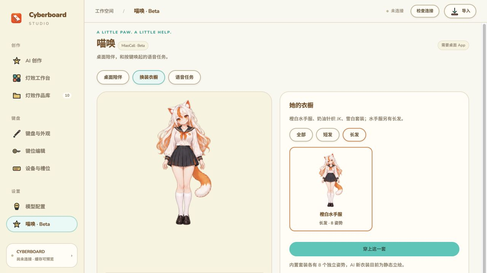

## 这一版能做什么

- **AI 灯效创作**：接入 Kimi、MiniMax 或 DeepSeek，用文字和最多 3 张参考图创作；保留历史会话、独立版本与局部修改。
- **灯效工作台**：整机照片预览、亮度 / 节奏 / 配色调整、三槽草稿与同步前审核。内置 10 款可删除灯效，无需模型 Key 即可预览。
- **键盘与外观**：8 款 R4 / R6 正面外观，同作品、同一帧比较。Beta 14 专门改善从 AI 创作进入此页的卡顿：页面先显示，预览按可取消的小批次准备，只编译当前展示帧。
- **两种界面风格**：「经典深色」与「暖岛浅色」在设置中即时切换，重开后保留；不改变作品 RGB 或槽位。
- **键位编辑**：独立页面显示 81 个实体键、7 层可读功能；先编辑本机草稿，审核专用计划后才写入。未知原始码保留，Fn 功能不再只是一串数字。
- **AI 语音输入**：单独配置 MiniMax、千问或 OpenAI 的语音转文字模型，识别后检查文字，再手动发送制作灯效。
- **喵唤 MiaoCall · Beta**：macOS 按住物理「·」说话，喵娘浮层显示识别与任务进度，可拖到桌面合适位置。默认关闭，开启后才注册快捷键。

## 界面预览

### 暖岛浅色 · AI 创作

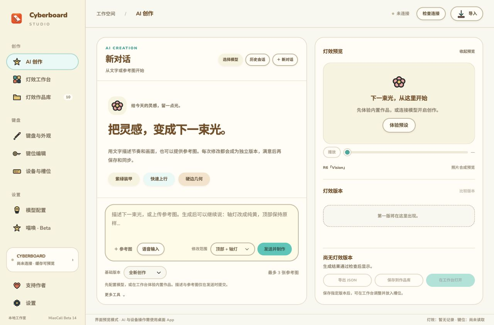

### 经典深色 · 灯效工作台

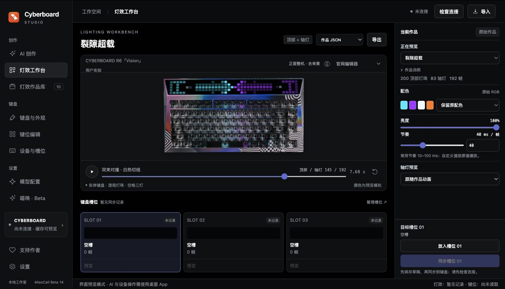

### 外观选择

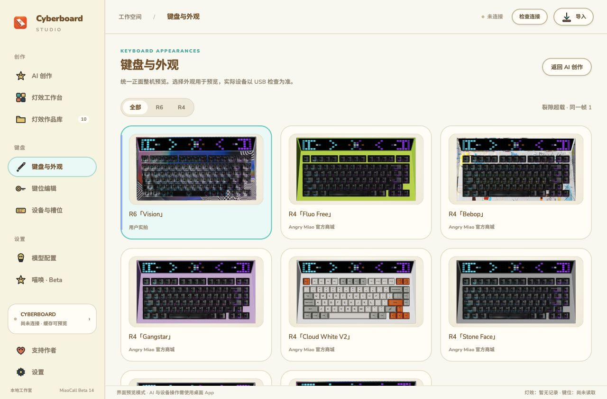

截图来自独立的界面演示环境；没有个人密钥、会话或真实设备记录。预览使用去背景键盘照片合成顶部和轴灯，不代表实机色准测量。

## 下载与运行

| 平台 / 版本 | 下载 | 说明 |
| --- | --- | --- |
| **macOS · MiaoCall Tasks Private Beta 3** | [私有测试包与 SHA-256](https://github.com/maestrokaka/cyberboard-studio-miaocall/releases/tag/v1.0.0-miaocall.tasks.beta.3) | Apple Silicon，macOS 13 及以上；含 CLI 与运行环境 |
| Windows · **历史 RC2** | [RC2 普通 x64 / Windows 10 兼容包](https://github.com/maestrokaka/cyberboard-studio/releases/tag/v1.0.0-rc.2) | 旧版灯效功能，不含本次新增界面、语音和喵唤；原生 GUI / USB 仍待实机验收 |

Mac 下载 `Cyberboard-Studio-1.0.0-miaocall.tasks.beta.3-macOS-Apple-Silicon.zip`，解压后将 App 放入「应用程序」。不要只下载 GitHub 的 Source code；旁边的 `.zip.sha256` 用于校验。无需另装 Python。当前没有 Intel Mac、Windows 32 位或 ARM64 原生新包。

App 使用本机 ad-hoc 签名，尚未进行 Apple Developer ID 签名或公证。首次打开时在“应用程序”中 Control-click App，选择“打开”，再在系统确认窗口中选择“打开”。不要关闭 Gatekeeper，也不要把网上复制的隔离属性移除命令作为常规安装步骤。喵唤需要的麦克风、全局按键及 Spotify 自动化权限只在明确开启对应功能时请求。升级前先退出旧 App，固定使用同一份已签名包。[私有版安装与权限说明](docs/PRIVATE_MACOS_INSTALL.md) · [详细 Beta 说明](docs/MIAOCALL_BETA.md)

## 五分钟开始创作

1. **先看预设**：打开「灯效工作台」，无需 Key 即可选择内置作品并预览。
2. **连接创作模型**：在「模型配置」选择 Kimi、MiniMax 或 DeepSeek，填写有权限的 Key 并保存。
3. **描述你的画面**：进入「AI 创作」，例如「橙红火焰从底部窜起，轴灯像余烬，4 秒循环」，也可上传参考图。
4. **逐版修改**：选择明确的基础版本和修改范围，例如「仅轴灯改成纯黄，顶部保持原样」。原版本保留。
5. **保存和同步**：满意后保存指定版本，或在工作台打开；放入目标槽位草稿，检查连接与同步计划，再确认写入。

文字与参考图仅在点击制作时提交给你选择的创作服务。Key 按服务直接保存在本机普通文件，默认隐藏并可显示；不读取、解密或迁移旧 Keychain / DPAPI 记录。

## 喵唤：按住一颗键，说出想做的事

1. 安装并登录本机 Codex，进入「喵唤 · Beta」→「语音任务」。文字任务可直接使用。
2. 选择工作目录。默认只读，需要修改时再明确勾选；可添加文件。
3. 输入任务并提交；也可配置 MiniMax / 千问 / OpenAI 语音服务，开启快捷键后按住「·」交代，确认文字后提交。
4. 在任务详情查看步骤、回答问题或逐次授权，检查返回结果与文件；同一任务可继续追问，执行中可补充文字指令。

使用官方本机 app-server，保存喵唤自己创建的任务会话。支持文件整理、资料摘要、项目修改等，实际能力取决于本机 Codex 工具和连接。Spotify 是可选示例，保留实际播放验证。WorkBuddy、千问办公和豆包工作尚未接入。[完整任务说明与数据范围](docs/MIAOCALL_TASKS.md)


不开启时「·」正常输入。喵唤不会随 App 启动自动启用，退出后释放监听。桌面语音 / 浮层当前仅支持 macOS。[完整连接、权限和故障排查](docs/MIAOCALL_BETA.md) · [键位与 AI 输入框语音说明](docs/KEYMAP_VOICE_LOCAL.md)

## 内置灯效 GIF


我已经借助 AI 创作并打磨了 **10 款灯效**，全部内置到软件中。无需配置模型，打开就能预览，选好后即可同步到键盘。

想做自己的灯效，也可以接入 **Kimi、MiniMax 或 DeepSeek**，写下你的想法，让 AI 帮你创作。

有想要的主题、角色或灯效，欢迎[到 GitHub Issues 留言告诉我](https://github.com/maestrokaka/cyberboard-studio-miaocall/issues)。附上一句话描述或参考图，下一款内置灯效，也许就来自你的脑洞。

下方是这 10 款灯效的整机动态预览，点击动图可查看大图。

| 预设 | 预设 |
| --- | --- |
| **01 裂隙超载**<br>青紫装甲与裂隙转场 · 7.68 秒<br><a href="docs/previews/neon-rift.gif">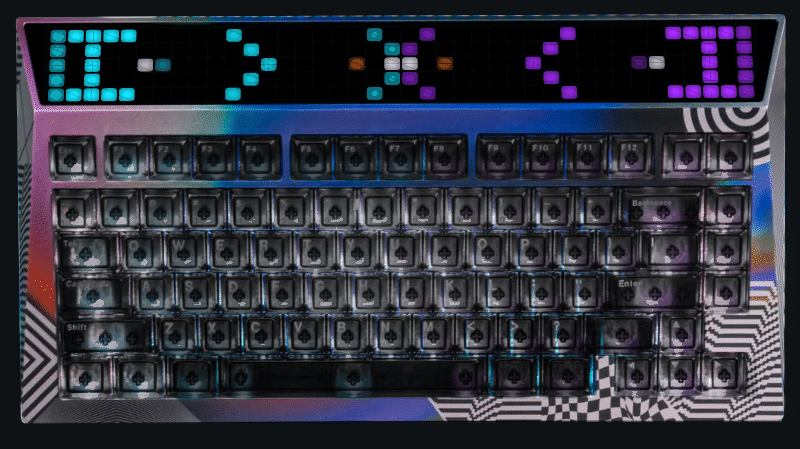</a> | **02 数据暴雨**<br>绿色数据光点与落雨 · 7.68 秒<br><a href="docs/previews/data-storm.gif">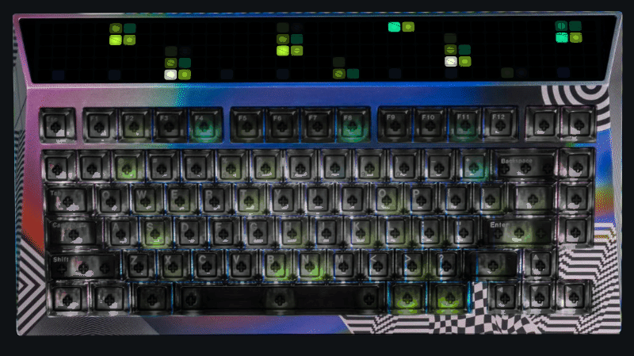</a> |
| **03 红线竞速**<br>红白轨迹与速度感 · 7.68 秒<br><a href="docs/previews/redline-rush.gif">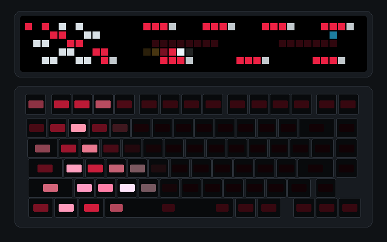</a> | **04 EVA初号机 · 觉醒序列**<br>紫绿装甲、眼部与觉醒阶段 · 4.8 秒<br><a href="docs/previews/eva-awakening.gif">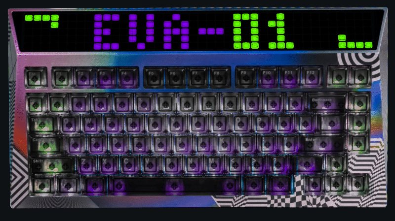</a> |
| **05 故障字标 · 终端夺权**<br>宽幅赛博字标与错位转场 · 4.8 秒<br><a href="docs/previews/glitch-override.gif">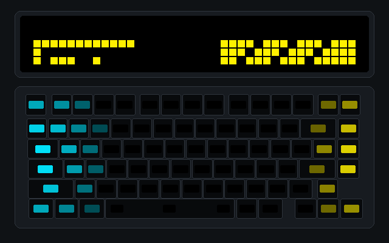</a> | **06 马里奥 · 红帽闯关**<br>纯红帽子与像素闯关 · 4.2 秒<br><a href="docs/previews/mario-run.gif">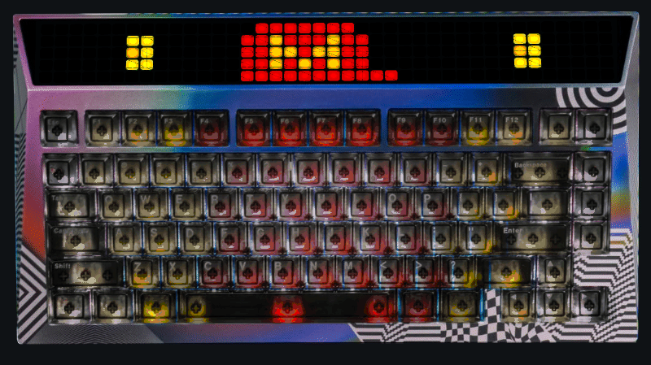</a> |
| **07 猫逐萤火**<br>小猫与萤火追逐 · 6 秒<br><a href="docs/previews/cat-firefly.gif">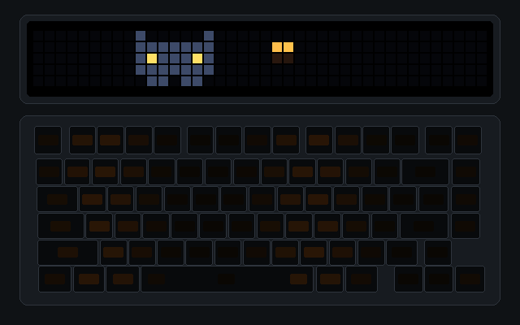</a> | **08 卡卡 · 红黑22**<br>球星卡、肖像与姓名号码 · 4.8 秒<br><a href="docs/previews/kaka-rossonero.gif">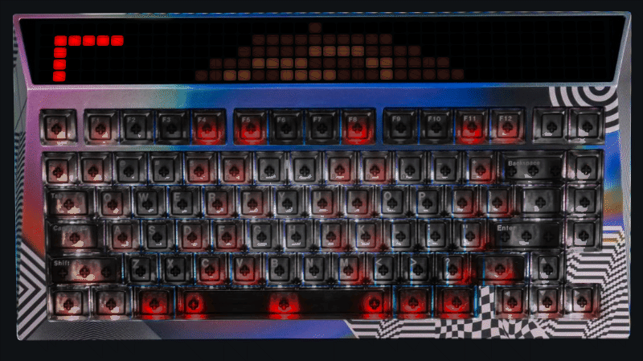</a> |
| **09 卡卡 · 极速突破**<br>带球动作与清楚的 KAKA 22 · 4.8 秒<br><a href="docs/previews/kaka-breakaway.gif">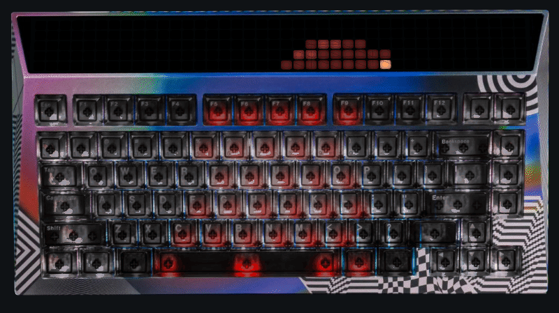</a> | **10 卡卡 · 圣西罗之夜**<br>庆祝姿态与红白旗浪 · 4.8 秒<br><a href="docs/previews/kaka-san-siro.gif">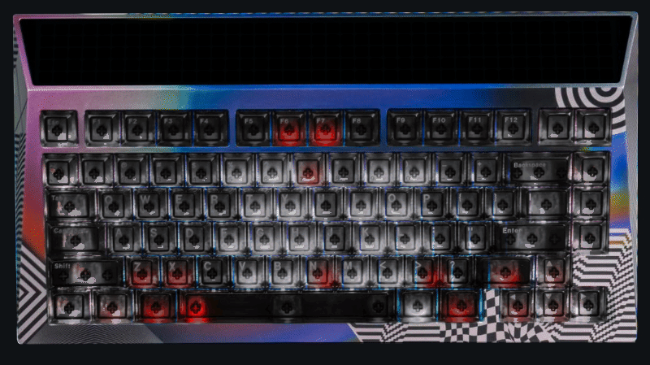</a> |

<details>
<summary>关于动图预览</summary>

动图采用 CYBERBOARD R6「Vision」去背景正面实拍照片，与 App 共用预览渲染器，合成顶部与轴灯的完整原速动画。源作品 RGB 与节奏不变；GIF 编码可能产生轻微色差，照片合成预览不代表实机色准。[GIF 校验记录](docs/previews/manifest.json) · [三款卡卡的优化过程](docs/LIGHTING_DESIGN_NOTES.md)

</details>

## 数据与验证范围

个人作品、会话、参考图、槽位草稿、Key 和设备记录与 App 安装目录分开保存，不进入源码或发布包。录音最长 60 秒，仅在明确操作后采集；临时录音结束或取消后清理，不进入作品库或工作区。同步灯效和修改键位分别需要专用计划与确认，不会因打开 App、切换外观或更新软件自动写入键盘。

Beta 14 已验证 14 组前端 / 预览回归、照片像素与 83 颗轴灯遮罩一致性、首次及再次进入外观页、macOS 签名包搬移启动和工作区保存恢复。语音请求的 TLS 漏包问题已修复，证书和主机名验证保持开启。Windows 原生界面 / USB、更多固件及 R4 对应写入仍需实机验收；不将本版标为正式稳定版。

## 从源码构建


需要 Python 3.12、Node.js；Mac 构建还需 Xcode Command Line Tools，Windows 构建还需 .NET 10 SDK。

本仓库保留经过验证的 CLI 0.1.2 源码、R6 识别与跨平台补丁，见 [CLI 来源与许可证](vendor/README.md)。源码素材在 `data/`，测试使用合成配置，不能将其当作真实设备基线。

Mac，在仓库根目录执行：

```sh
python3 scripts/setup-cli.py --env-dir .tools/macos-build --with-pyinstaller
.tools/macos-build/bin/python scripts/build-macos-backend.py
python3 scripts/prepare-data.py
native/build.sh --backend-dir build/macos-backend/CyberboardBackend
```

这会先冻结独立后台，再生成 `build/Cyberboard Studio.app`。Mac 构建会检查发布素材不含个人基线，并验证签名。

Windows 独立运行环境准备与校验见 [运行环境构建说明](windows/runtime-readme.txt)。准备 `windows/runtime/python` 后：

```sh
python windows/build.py --dotnet /path/to/dotnet --nuget /path/to/nuget-cache --bootstrapper /path/to/MicrosoftEdgeWebview2Setup.exe
```

`--dotnet`、`--nuget` 可省略以使用本机 SDK 与仓库内缓存；软件包始终包含完整运行组件。Windows 使用 `EnableWindowsTargeting`，允许从 Mac 交叉编译。WebView2 引导安装器来自 [Microsoft 官方下载](https://go.microsoft.com/fwlink/p/?LinkId=2124703)。

可选重建 GitHub 的十款照片合成 GIF：使用已安装 Pillow 的 Python 环境、Node.js 与 `@napi-rs/canvas`，在仓库根目录执行；这是发布素材工具，不是 App 新增的视频导出功能。

```sh
npm install --prefix .tools/gif-render @napi-rs/canvas
python scripts/build-preset-gifs.py
```

生成器默认查找 `.tools/gif-render/node_modules`，也可通过 `STUDIO_CANVAS_MODULE` 指定 Canvas 模块。它用 App 预览引擎合成照片动画；临时 PNG 只写入 `build/`，不上传。

## 离线验证

通用任务新增 `tests/agent-tasks-check.py` 与 `tests/agent-tasks-ui-check.cjs`；`python scripts/check-release.py --mac-native` 是本机离线发布检查入口，GitHub Actions 自动运行相应检查。桌面陪伴保留 `tests/companion-check.py`、`tests/companion-native-check.py` 与 `tests/companion-package-check.py --app APP路径`，覆盖衣装生成边界、32 个姿势、60 条音频解码、停留冷却、设置与真实软件包连接配置。

```sh
node tests/model-check.cjs
node tests/presets-check.cjs
node tests/frontend-regressions.cjs
node tests/library-ui-check.cjs
node tests/renderer-check.cjs
node tests/preview-selector-check.cjs
node tests/ui-check.cjs
node tests/ai-ui-check.cjs
node tests/chat-ui-check.cjs
STUDIO_UI_PLATFORM=windows node tests/ui-check.cjs
.tools/macos-build/bin/python tests/backend-check.py
.tools/macos-build/bin/python tests/ai-recipe-check.py
.tools/macos-build/bin/python tests/kimi-ai-check.py
.tools/macos-build/bin/python tests/kimi-ai-extra-check.py
.tools/macos-build/bin/python tests/multi-provider-ai-check.py
.tools/macos-build/bin/python tests/ai-conversation-check.py
.tools/macos-build/bin/python tests/workspace-conversation-check.py
.tools/macos-build/bin/python tests/ai-images-check.py
.tools/macos-build/bin/python tests/native-ai-check.py
.tools/macos-build/bin/python windows/tests/migration-check.py
```

测试使用设备和 HTTP 替身，不访问 USB，也不消耗真实模型额度。发布包另外检查依赖校验和、架构、许可证、无个人状态，以及 Mac 后台整体搬移后的运行能力。

## 代码结构

- `web/`：灯效工作台、JSON 模型、照片预览和已确认的 Logo。
- `backend/bridge.py`：CLI 桥接、备份、同步计划、实际传输与验证。
- `backend/kimi_ai.py`、`lighting_recipe.py`、`ai_images.py`：模型调用、有限灯效编排与参考图规范化。
- `native/`：macOS 窗口、原生文件对话框、后台通信与同步保护。
- `windows/src/`：WinForms / WebView2 窗口、文件对话框和后台进度。
- `windows/runtime/`：Windows 运行环境的官方来源、固定版本和准备脚本。
- `vendor/`：CLI 源码、补丁说明及第三方许可。
- `data/`：灯效作品、公开预设目录 `preset-catalog.json`、照片校准、通用实体布局与合成测试 fixture。
- `scripts/`：环境准备、素材生成和 Mac 后台构建。

## 发布维护

当前私有 `feature/miaocall-companion` 包含 Tasks Beta 3 源码与素材；不推送公开 main，也不上传个人测试录音、声纹源文件或桌面录制素材。公开 Beta 14、旧 RC2 的标签和附件保持原样。后续问题欢迎附上版本、系统、键盘型号和复现步骤，到 [Issues](https://github.com/maestrokaka/cyberboard-studio-miaocall/issues) 反馈。

## 支持作者


**键盘已经亮了，咖啡杯还空着。☕**

如果 Cyberboard Studio 帮你点亮了喜欢的灯效，欢迎请 **Kakà** 喝杯咖啡，给下一次灵感补一点咖啡因。金额随心，心意满格；支持完全自愿，不影响任何功能的使用。

<p align="center">
  <a href="docs/assets/wechat-support.svg"></a>
  <br />
  <strong>微信扫一扫 · Kakà</strong>
  <br />
  <sub>点击二维码可查看大图</sub>
</p>

有 Bug、有脑洞，或者想聊聊你的键盘，欢迎写信给 [maestrokaka@gmail.com](mailto:maestrokaka@gmail.com)。

**咖啡可以扫码，问题请走邮件。** 付款留言不方便跟进，别让你的好点子迷路了。

如果你需要英文界面的 App，欢迎联系我：[maestrokaka@gmail.com](mailto:maestrokaka@gmail.com)。
