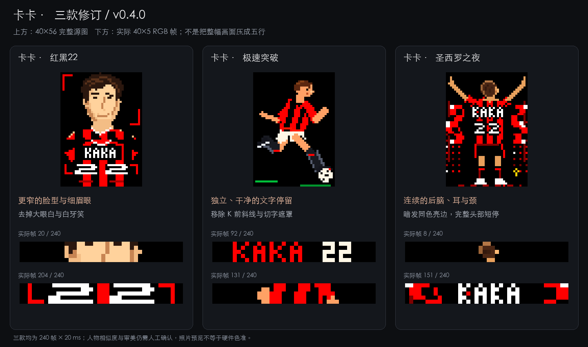

# 灯效改稿与 AI 提示词改进

这次从三款 AC 米兰卡卡灯效的实际预览出发，修正肖像、文字和头部轮廓，再把可复用的经验写入有参考图与无参考图的创作要求。三款卡卡的改稿与提示词改进对应 **v0.4.0 预览版**；v0.4.1 的完整预设范围见[后续收录](#preset-scope-v041)。

[返回项目首页](../README.md) · [AI 创作使用说明](USER_GUIDE.md#creative) · [公开预设目录](../data/preset-catalog.json)

## 三款分别改了什么

| 作品 | 预览中发现的问题 | 本次修正 | 后续提示词应表达什么 |
| --- | --- | --- | --- |
| 卡卡 · 红黑22 | 肖像偏通用卡通脸，大眼白和露齿笑抢走人物特征 | 收窄拉长脸型，改为短棕侧分、细短深棕眼、窄鼻和闭口浅笑，调整五官比例 | 明确脸型、发型、眼鼻口的相对位置；先保留身份特征，再补像素装饰 |
| 卡卡 · 极速突破 | `KAKA 22` 前多了一道看似字符的红斜线，入出场还会露出半字 | 删除文字镜头里的斜线和局部裁切；完整姓名号码连续停留 28 帧，即 0.56 秒 | 文字独立成镜头，完整字形、干净留白，与人物、拖尾和装饰图层互斥 |
| 卡卡 · 圣西罗之夜 | 黑底上深棕头发难辨，后脑缘被涂黑，五行视窗也难以同时容纳头颈 | 连通头顶、后脑、耳朵和颈部，以克制的棕色亮边分离轮廓；先短暂等比显示完整头部，再连续近距离滚动 | 先检查完整主体边界与暗部连续性，再检查实际窗口；重要部位给完整识别机会 |

第一款的调整依据人物特征与本轮预览反馈完成；本轮没有取得可逐像素对照的官方肖像照片，因此不把它表述为照照片临摹或精确肖像还原。第三款也并非简单漏画了几行：暗色轮廓、图层覆盖和窗口截取共同造成了「头部缺失」的观感。

三款保持原有作品编号，均为 **240 帧 × 20 ms，4.8 秒一轮**。此次还原脸部、清理文字或补清头部，没有借机改动键位；作品 JSON 只包含灯效。v0.4.0 中，原已确认的「初号机 · 拘束解除」保持原版，故障字标也按已确认的版本收录。

## 先画完整，再看五行怎么经过

实体顶屏是 **40×5，共 200 颗灯**。软件支持用更高的虚拟像素图安排镜头，但每一帧最终仍只显示这五行。大图完整，并不代表播放时能看清脸、耳朵或完整文字。

对完整角色、人物或高标志，创作要求调整为：

1. 先画完整主体，保留头顶、耳朵、手臂等关键部位的边界，留出必要余量。
2. 需要宽幅快滚时，让实际主体轮廓优先覆盖约 **34–38 列**，横纵采用同一比例。透明边距不计入主体宽度。
3. 用连续纵向运动展示完整造型，缩短无效空场。一次快速通行通常约 **1.2–2 秒**，根据主体高度与可读性调整。
4. 给脸、标志、姓名或号码安排识别停留，随后衔接动作或下一镜头。单次通行时间与整套循环时长分开设计。
5. 同时看完整源图、五行输出和整机动态预览，再检查回环。

适合原生五行的角色可以直接用眨眼、摆动等微动作；几何、节奏、渐变、静态或暗场作品按自身主题编排。高画布与快滚是一种表达方式，不是所有创作的统一模板。

内部像素图的上限提高到 **40×64，最多 2,560 格**。这让较完整的人物轮廓和动作有容纳空间，仍受有限图层、帧数和计算预算约束。增加画布或帧数本身不会自动提高画面质量。

## 有参考图：先锁定特征，再安排动作

有图时，提示词应先提炼能在低分辨率里保留的特征：主体轮廓、脸型或姿势、发型、特征色、关键配件与空间关系。照片里的强反光、环境背景和细碎纹理可按灯板能力取舍。人物尤其需要看五官比例，单纯加大眼睛或提亮牙齿容易让不同人物变成同一张卡通脸。

用户只需提供图片，再补一句方向。例如：

> 保留图中的侧分短发、窄长脸和红黑球衣。完整人物向上快速滚动，脸部稍停，最后清楚显示 KAKA 22，轴灯以红色呼应动作。

给黑色或深色角色，可以补充：

> 保留深色主体，头顶、耳朵和颈部轮廓要连贯，用同色亮边与黑底分开。

参考图中的文字作为素材处理；用户明确写出的文字应完整呈现。多图时优先厘清哪张负责人物、哪张负责配色或风格，避免无意混合身份特征。

## 无参考图：给一个清楚的主题与动作

无图时，模型需要从描述里建立主角、配色与动作。日常语言应足够使用；用户不用替模型写坐标和逐帧数组。

> 红黑球衣的足球运动员带球突破，白色短裤，动作有加速感，最后清楚显示 KAKA 22，轴灯跟着推进。

> 青紫色硬边几何在长屏两侧交错合拢，轴灯分区切换，节奏利落，4 秒循环。

内部要求会补充构图、时间轴、轴灯配合与循环。抽象作品需要明确的节奏、空间变化和阶段关系；人物作品需要可辨的轮廓和动作。没有参考图的姓名与主题提示，不能保证生成精确的人物肖像。

## 文字要有自己的干净镜头

第二款的问题可追溯到绘制文字之后额外添加的红色斜线，并非缓存或人物残影。删除多余图形后，还要看文字进入、完整停留和退出三个阶段。

本次 `KAKA 22` 使用原生五行字形：K 保留直立主干和两条可辨的臂，整段实际占 29 列，左右分别留 5 和 6 列纯黑。完整停留段逐帧检查了预定字形与黑色留白。

可复用要求是「按实际字形边界居中、留出足够间隔、完整停留、文字与装饰互斥」。不同长度的字标应重新排版，不把本例的固定边距机械套给所有文字。若采用故障、错位或碎裂转场，仍需有完整可读的识别阶段，避免整轮只看到半字。

## 暗色与特征色需要分别处理

第三款原头发颜色为 `#30180C`，在黑底上加上被涂黑的后脑边缘，容易丢失轮廓。本次保留棕色头发，以 `#4A2614` 主体、`#9B6336` 边缘和少量 `#B47746` 高光建立连续结构；并调整遮挡顺序，让旗帜和手臂不覆盖头部特征。它使用短暂的完整头部视图，再平滑进入近距离扫描。

这与此前实机发现的「皮卡丘不黄、马里奥帽子不红」形成两条共同规则：

- 有明确特征色的主体优先用干净、饱和的主色，轴灯提供可辨的主题亮区，避免把照片反光当成主体固有色。
- 深色主体保留深色，用同色明暗层次交代完整边界；明确要求的白色、粉彩、柔光、渐变或低亮意图仍优先。

内部编排新增的 `dominant` 混色会保留较强图层的整组 RGB，帮助减少异色逐通道叠加造成的近白泛色。黑色遮挡仍可使用 `replace`，原有 `add` / `max` 配方行为保持兼容。已有或导入作品不会被自动重涂。

预览灯珠中心使用原始 RGB；亮度滑块单独调整观看和槽位参数。显示器、照片曝光、键帽和实体 LED 仍会影响观感，RGB 数值检查并非实机色准或光度测量。

## 哪些检查能自动做，哪些还要看效果

| 层次 | 本轮检查内容 | 能支持的结论 |
| --- | --- | --- |
| 数据与编译 | 有限画布与计算预算、帧数、RGB、每帧 200 / 90 色、7 个轴灯保留位置为黑 | 数据可以按受支持格式处理 |
| 具体预设 | 姓名镜头字形与留白、头部遮挡、源图边界、首尾衔接、导入导出及槽位合并 | 本次改稿的已知问题受到针对性检查 |
| 动态观看 | 完整高图、真实 40×5 输出、整机照片和轴灯配合 | 评估主体是否能读、节奏是否舒服、画面是否完整 |
| 实体键盘 | 本轮未进行 USB 写入或重新实拍 | 本轮结果不构成新的硬件颜色验收 |

通用 AI 质量检查关注明显不可见、意外静止、弱轴灯、异色泛白与接缝等基础问题，最多使用一次修复机会。卡卡改稿中的字形和轮廓断言是针对这组预设的检查，并不表示 App 已有自动肖像相似度或通用审美评分。

这批预设通过手工像素编排、针对性修正与动态预览完成；本轮没有重新调用真实模型 API。提示词改进将指导后续生成，是否提高某个模型的实际成片率，仍需用有图、无图的真实创作继续验证。

## 后续收录：v0.4.1

最终确认的主库共 **10 款**，顺序为：裂隙超载、数据暴雨、红线竞速、EVA初号机 · 觉醒序列、故障字标 · 终端夺权、马里奥 · 红帽闯关、猫逐萤火、卡卡 · 红黑22、卡卡 · 极速突破、卡卡 · 圣西罗之夜。本页保留上方 v0.4.0 的三款卡卡诊断、过程图与修正依据。

| 本次收录 / 调整 | 表达与沿用内容 | 循环 |
| --- | --- | --- |
| EVA初号机 · 觉醒序列 | 丰富版人物镜头，装甲、眼部与觉醒阶段连续展开 | 240 帧 × 20 ms，4.8 秒 |
| 马里奥 · 红帽闯关 | 保留此前确认的纯红帽子及原始 RGB 帧，简化作品名称 | 140 帧 × 30 ms，4.2 秒 |
| 猫逐萤火 | 保留小猫追逐萤火的原始动画与节奏 | 100 帧 × 60 ms，6 秒 |

这批预设按用户最终选择收录，帧数与时长各自服务于画面，不统一套用 4.8 秒。高图快滚适合完整人物的连续呈现，原生五行、静态、微动作及抽象作品仍按各自主题编排。[十款 GIF 总览](../README.md#内置灯效-gif)展示真实作品帧的顶屏与轴灯示意，使用原始 RGB 和完整原速时间轴；它不是实机色准测量。

原「初号机 · 拘束解除」保留在源码、已发布的 v0.4.0 和旧工作台兼容数据中，新主库采用用户确认的丰富版。内置作品现也可从本机库删除、恢复或确认后永久清理；这些库操作不改动实体键盘，也不自动恢复已取消的槽位草稿。
