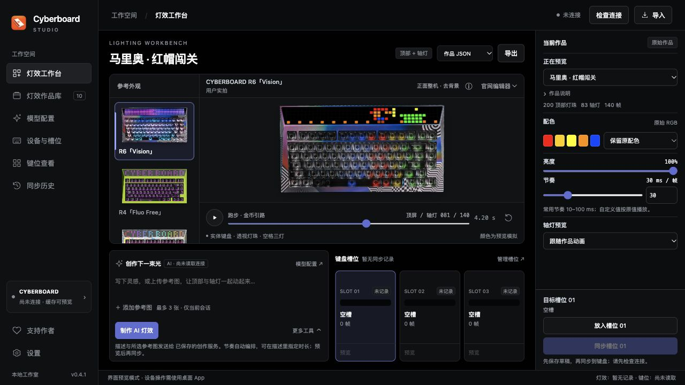
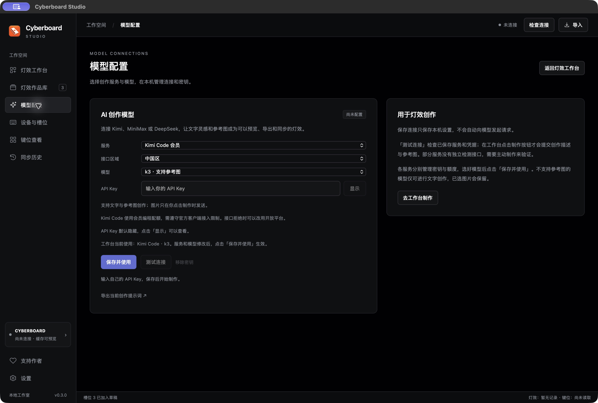
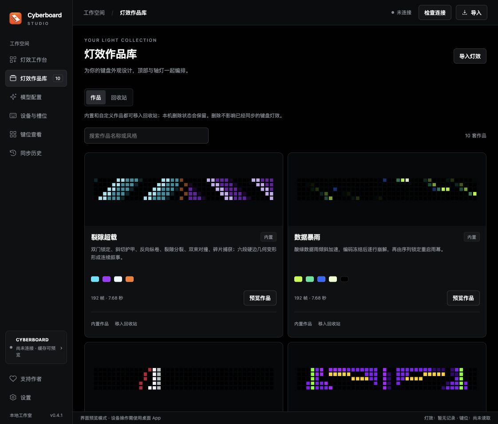
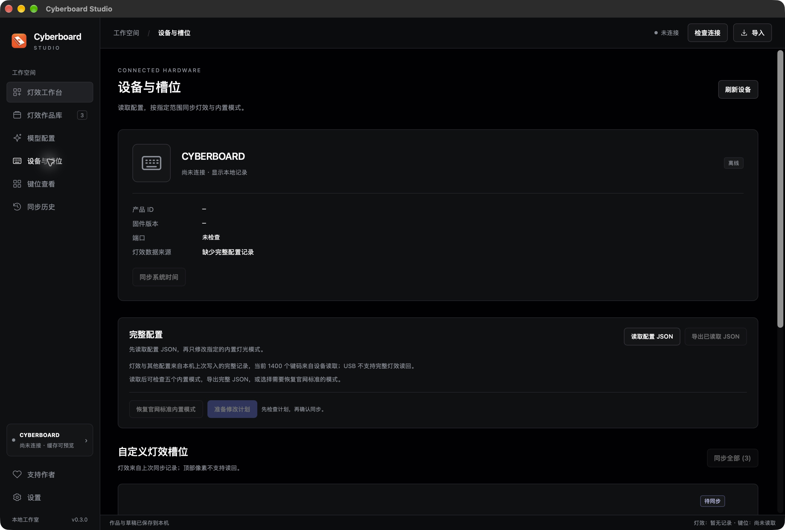

# Cyberboard Studio 完整使用说明

适用版本：**v0.4.2 预览版** · macOS / Windows

Cyberboard Studio 用来预览、整理和同步 Cyberboard R4 / R6 的顶部灯效与轴灯。你可以先离线预览，或连接 Kimi、MiniMax、DeepSeek，用文字与支持的参考图制作新动画，再检查 USB 连接，把作品放入三个自定义槽位，查看同步计划后写入键盘。

[下载软件](https://github.com/maestrokaka/cyberboard-studio/releases) · [返回项目首页](../README.md) · [反馈问题](https://github.com/maestrokaka/cyberboard-studio/issues)

## 目录

- [1. 下载与安装](#install)
- [2. 五分钟上手](#quick-start)
- [3. 界面与数据来源](#interface)
- [4. 整机、顶部与轴灯预览](#preview)
- [5. 配色变体与 AI 创作](#creative)
- [6. 作品库与 JSON 导入导出](#json)
- [7. 首次同步：准备原配置记录](#baseline)
- [8. 连接键盘与查看设备](#device)
- [9. 槽位草稿与实际同步](#sync)
- [10. 查看键位与同步时间](#keys-time)
- [11. 同步历史与灯效恢复](#history)
- [12. 本机数据、备份与软件更新](#data)
- [13. 快捷键与其他界面](#shortcuts)
- [14. 常见问题与故障处理](#faq)
- [15. 灯效 JSON 格式参考](#format)

## 1. 下载与安装

在 [v0.4.2 下载页](https://github.com/maestrokaka/cyberboard-studio/releases/tag/v0.4.2) 的 **Assets** 中选择对应 ZIP。旁边的 `.zip.sha256` 是校验文件，不是安装包。GitHub 的 `Source code` 是源码，普通使用请下载下表的软件包。

| 电脑 | 下载文件 | 当前适用范围 |
| --- | --- | --- |
| Mac | `Cyberboard-Studio-0.4.2-macOS-AppleSilicon.zip` | Apple Silicon（M 系列芯片），macOS 13 及以上 |
| Windows | `Cyberboard-Studio-0.4.2-Windows-x64.zip` | Windows 11 x64；部分受 .NET 10 支持的 Windows 10 LTSC / Enterprise |
| Windows 10 兼容包 | `Cyberboard-Studio-0.4.2-Windows10-Compatibility-x64.zip` | 旧 Windows 10 明确出现 CET 启动兼容错误时单独测试，详见[故障处理](#faq) |

当前没有 Intel Mac 构建；Windows 32 位和 ARM64 原生版本尚未提供。Windows 系统兼容范围可参阅 [Microsoft 的 .NET 10 支持列表](https://github.com/dotnet/core/blob/main/release-notes/10.0/supported-os.md)。

### macOS

1. 解压 Mac ZIP。
2. 把 `Cyberboard Studio.app` 拖入「应用程序」。
3. 双击打开，进入灯效工作台。

此版本带运行环境和 CLI 后台，无需另外安装 Python 或 CLI。它使用本机 ad-hoc 签名，尚未进行 Apple Developer ID 签名或公证。

若首次打开提示无法验证开发者，确认下载来源后，按 Apple 的流程进入「系统设置 → 隐私与安全性」，使用针对这个 App 的「仍要打开」，再确认打开。具体以 [Apple 官方说明](https://support.apple.com/en-gb/102445) 为准。若提示文件损坏，先重新下载并核对 ZIP，不把损坏提示当成普通的开发者验证提示。

### Windows

1. 将整个 ZIP 解压到普通文件夹，例如 `D:\Apps\Cyberboard Studio`。
2. 双击 `Cyberboard Studio.exe`。
3. 保留同目录的 DLL、`resources`、`Dependencies` 等文件，不单独移动 EXE，也不直接在 ZIP 内运行。

软件包带 Python、CLI 和 .NET 运行组件。若提示缺少 WebView2，关闭 App，运行 `Dependencies\MicrosoftEdgeWebview2Setup.exe`，联网完成安装后重新打开。WebView2 是界面所需的独立运行组件，详见 [Microsoft 官方说明](https://learn.microsoft.com/en-us/microsoft-edge/webview2/concepts/distribution)。

Windows 版已完成交叉编译与离线检查，**Windows 原生启动、本机 Key 保存与旧配置迁移及真实 USB 通信尚待实机验证**。发布说明会记录后续验证结果。

优先使用普通 Windows 包，它保留 CET 硬件栈保护标记。兼容包仅针对日志明确写着「Your Windows doesn't fully support CET」的旧系统启动问题，取消此 App 的 CET 标记；不修改 Windows 系统安全设置，也不代表扩大了 .NET 官方支持范围。建议先安装系统累计更新，不能更新时再独立解压兼容包测试，不混用两种包的文件。

## 2. 五分钟上手

### 先看效果，不需要连接键盘

1. 打开「灯效工作台」，在右侧「正在预览」选择作品。
2. 点击预览左侧「参考外观」中的键盘小图，查看统一的正面整机去背景效果；当前选择会高亮显示。
3. 使用播放、暂停和时间轴查看顶部与轴灯动画。
4. 调整「亮度」和「节奏」。想换配色时，选择「变体色系」，在 AI 创作区「更多工具」中点「生成模板变体」。
5. 选择「作品 JSON → 导出」，保存这套作品。

### 用 AI 制作一套新作品

1. 点左侧「模型配置」或工作台「模型配置 ↗」，选择 Kimi、MiniMax 或 DeepSeek 及有权限的模型；新连接默认保留 Kimi Code 的 `k3`。
2. 在 App 中输入自己的 API Key，点「保存并使用」；可以先点「测试连接」。
3. 回工作台，在预览下方常驻的 AI 创作区填写描述；使用支持参考图的模型时，也可点「添加参考图」选择 1–3 张图片。
4. 点制作按钮（显示当前服务，如「用 MiniMax 制作灯效」），等待编排和帧校验；成功后自动选中并播放。
5. 检查整个循环，在右侧调整亮度与节奏；在「作品名称」中命名并保存，导出或放入槽位。

AI 制作需要联网及有效的对应服务密钥；Code 客户端限制、参考图传输与完整操作见[第 5 节](#creative)。不连接键盘也能制作，生成成功不会自动写入 USB。

### 把一套作品同步到槽位 01

已有[这把键盘的可信原配置记录](#baseline)时，按下面步骤只替换指定槽位。没有记录时，App 会提供首次配置入口；首次配置会建立整份新配置，替换旧灯效与其他模式，具体范围见[首次配置说明](#first-setup)。

1. 用数据线连接键盘，关闭其他占用键盘的配置软件。
2. 点「检查连接」，在「设备与槽位」核对实际产品 ID 和固件。
3. 回到工作台，选择作品并调整亮度、节奏。
4. 点击预览底部的 `01` 槽位卡选择目标，在右侧将当前作品放入槽位草稿。
5. 点「同步槽位 01」，确认计划中待修改槽位只有 `01`，核对备份和参数。
6. 点「同步到键盘」，保持连接，等待传输、提交和键位验证全部完成。

**选择槽位和放入草稿都不会写入键盘。** 实际写入发生在同步计划中点击「同步到键盘」之后。首次操作建议完整阅读[同步说明](#sync)。

## 3. 界面与数据来源

| 页面 | 用途 |
| --- | --- |
| 灯效工作台 | 中间大预览，下方常驻 AI 创作与三个槽位，右侧调整作品参数，制作、导出和准备同步 |
| 灯效作品库 | 搜索内置、导入、模板变体及 AI 作品，进入工作台预览 |
| 模型配置 | 与工作台并列的独立页面，选择 Kimi、MiniMax、DeepSeek 服务 / 区域 / 模型，保存、测试或移除密钥 |
| 设备与槽位 | 检查 USB、查看身份和固件、同步时间、读取配置 JSON、恢复指定内置模式、管理槽位草稿 |
| 键位查看 | 查看 81 个实体键的 7 层绑定与原始键码 |
| 同步历史 | 查看本机配置快照和同步前备份，准备灯效恢复计划 |
| 工作室设置 | 查看本地 CLI、固件、运行环境与预览说明；模型连接在「模型配置」中管理 |

启动 App 只载入本机作品和记录，不会自动调用模型、检查或写入 USB。连接状态是**上次手动检查的结果**；拔插或换设备后，请再次点击「检查连接 / 刷新连接」。

阅读界面时，区分以下来源：

- **作品 / 草稿**：正在设计或准备写入的内容。
- **上次同步记录**：本机保存的灯效配置，不能当成实时读取的 LED 像素。
- **实时键位**：手动检查连接后，从设备读取的键码。
- **未记录 / 空槽**：本机没有可显示的灯效记录，不能据此判断键盘实际没有灯效。

设备型号和固件请以手动检查后「设备与槽位」的实际结果为准，初始页面文字不代表已经识别到设备。

## 4. 整机、顶部与轴灯预览

### 参考外观与灯珠样式

| 控件 | 选择与效果 |
| --- | --- |
| 参考外观 | 点击预览左侧的键盘缩略图切换，选中项高亮；8 款已校准的 R4 / R6 外观，名单与照片来源见下表 |
| 预览画面 | 所有外观统一显示正面整机，沿外壳轮廓去除背景，完整展示键盘 |
| 灯珠样式 | 「官网编辑器」模拟官网编辑器的灯珠观感；「柔光灯珠」使用柔和发光效果 |
| 轴灯预览 | 「跟随作品动画」显示 JSON 轴灯；「关闭轴灯预览」隐藏模拟轴灯；「照片原始轴灯」显示照片自身灯光 |

| 参考外观 | 照片来源 |
| --- | --- |
| CYBERBOARD R6「Vision」 | 最早提供的正面实拍 |
| CYBERBOARD R4「Fluo Free」 | 怒喵官方商城 |
| CYBERBOARD R4「Bebop」 | 怒喵官方商城 |
| CYBERBOARD R4「Gangstar」 | 怒喵官方商城 |
| CYBERBOARD R4「Cloud White V2」 | 怒喵官方商城 |
| CYBERBOARD R4「Stone Face」 | 怒喵官方商城 |
| CYBERBOARD R4「Paisley」 | 怒喵官方商城 |
| CYBERBOARD R4「Vision」 | 怒喵官网 R4 产品页 |

「参考外观」位于大预览左侧，每张小图展示对应键盘外观，下方用 `R6「Vision」`、`R4「Fluo Free」` 等简洁标签标注，省去重复的 CYBERBOARD 前缀；主预览保留完整名称。点击小图即可切换大预览，当前项保持高亮；更多小图可在栏内滚动查看。窄屏时改为横向图条，左右滚动后点击选择。

所有外观都采用与 CYBERBOARD R6「Vision」一致的干净正面整机画面，沿实体外壳轮廓去除环境背景和镜面倒影。R4 与 R6 的「Vision」按型号分别提供，R6 使用最早提供的正面实拍；7 款 R4 外观取自官网与官方商城，包含仍有合格素材的售罄配色。当前外观会注明照片型号与来源；官网素材的原始像素保留，软件只按校准位置投影灯光，不会给其他配色重新涂色或生成不存在的实物外观。[官网素材来源、检索范围与校准记录](../data/photos/official-photo-sources.json)

切换外观不改变灯效 JSON、槽位草稿或实际连接的键盘型号。桌面版会记住所选外观，每款只提供校准后的正面整机画面。整机预览按可用空间自适应放大，保持完整轮廓与原始比例。预览不是实时摄像画面，也不会自动替换成你实际键盘的照片。

不透光键帽主要用键缝微光表现轴灯，透明键帽显示透光与反射。照片中原有的高光、曝光和材质会影响结果；这些是近似观感，不能用来测量真实 LED 亮度。

**轴灯预览选项只影响观看，不修改作品、导出或同步的轴灯数据。** 若想让键盘的轴灯真正关闭，需要使用轴灯帧全部为 `#000000` 的作品，而不是只关闭预览。

### 播放与参数

- **播放 / 暂停**：控制本地预览。
- **时间轴**：拖动到任意位置查看细节；拖动后动画会暂停，点播放继续。
- **重新播放**：从开头播放。
- **亮度**：`0–100%`，在原始 RGB 基础上调整整体亮度。
- **节奏**：常用滑块为 `10–100 ms / 帧`，旁边的数字输入支持作品格式的 `1–32767 ms / 帧`。超出滑块范围时显示「自定义节奏」，按输入的原值播放；回到 `10–100` 后滑块重新可用。数值越小，动画越快；`40 ms / 帧` 相当于每秒 25 帧。AI 新作品另外自动编排节奏与时长，不沿用这里的预览速度。

工作台中间为大预览，预览下方的 AI 创作区与三个槽位在桌面窗口中并排显示，右侧集中调整作品参数及放入草稿、准备同步。AI 创作始终在工作台可见。常用预览、参数、制作和槽位操作优先放在一屏；长内容、参考图较多或窄窗口时仍可在对应区域滚动查看。

顶部和轴灯可以有不同帧数，两条序列各自循环；时间轴显示顶屏、轴灯和共同循环进度。工作台时长表示两者一起回到起点所需的时间：例如顶部 192 帧、轴灯 42 帧、40 ms / 帧，联合循环为 1,344 帧，即 53.76 秒。作品库卡片的帧数与时长按顶部序列显示。

若系统启用了「减少动态效果」，初次预览可能默认暂停，手动点击播放即可。

预览使用作品的原始 RGB 数据，灯珠中心不再额外提亮或裁剪通道；亮度滑块单独作用于预览和槽位亮度，不把增益写进作品。但屏幕、照片曝光、键帽透光和实际 LED 都会影响观感。更改参考外观或灯珠样式不会重新校准实体颜色；最终效果以键盘实物为准。

## 5. 配色变体与 AI 创作

### 生成本地模板变体

1. 在工作台选择基础作品。
2. 选择「变体色系」：保留原配色、冰蓝 / 深紫、酸绿 / 电光蓝、热红 / 冷白或琥珀 / 钢蓝。
3. 调整节奏，在工作台的 AI 创作区写下备注。
4. 展开 AI 创作区的「更多工具」，点「生成模板变体」。新作品会进入作品库并自动选中。
5. 预览满意后，导出作品或放入目标槽位。

只改变色系下拉框不会立即给当前作品换色；需点击生成按钮。变体通过现有动画调整色相与节奏，保留动画结构；创作描述作为备注保存，不会驱动模型生成新剧情或转场。

### 第一次连接模型

1. 点击左侧工作空间中的「模型配置」，或创作区「模型配置 ↗」。这个页面与灯效工作台同级。
2. 选择服务；Kimi / MiniMax 选择「中国区」或「国际区」，DeepSeek 选择「标准地址」或「兼容 /v1 地址」。
3. 选择有权限使用的模型。Kimi Code 默认 `k3`，Kimi 开放平台默认 `kimi-k3`，MiniMax 默认 `MiniMax-M3`，DeepSeek 默认 `deepseek-flash`。各服务也可选择「自定义模型…」，填写官方模型 ID；以前保存的未知 ID 会保留。
4. 将自己的 API Key 输入密码框，点「保存并使用」。API Key 默认隐藏，点击旁边的「显示」可查看输入内容或当前服务已保存的 Key，再点「隐藏」收起，无需额外确认。
5. 点「测试连接」，检查服务和凭据是否可用；回到工作台制作。

| 服务 | 默认模型 | 中国区 / 标准地址 | 国际区 / 兼容地址 |
| --- | --- | --- | --- |
| Kimi Code 会员 | `k3` | `https://api.kimi.com/coding/v1` | `https://api.kimi.ai/coding/v1` |
| Kimi 开放平台 | `kimi-k3` | `https://api.moonshot.cn/v1` | `https://api.moonshot.ai/v1` |
| MiniMax | `MiniMax-M3` | `https://api.minimax.cn/v1` | `https://api.minimax.io/v1` |
| DeepSeek | `deepseek-flash` | `https://api.deepseek.com` | `https://api.deepseek.com/v1`（同服务的兼容路径） |

下拉框提供官方模型 ID，切换模型不等于获得权限。Kimi 参见[模型配置](https://www.kimi.com/code/docs/kimi-code/models.html)和[密钥获取](https://platform.kimi.com/docs/get-api-key)；MiniMax 参见[官方兼容接口](https://platform.minimax.cn/docs/api-reference/text-openai-api)；DeepSeek 参见[官方模型列表](https://api-docs.deepseek.com/quick_start/pricing/)。当前仅接入这些服务的官方地址，不支持任意第三方网关。

**参考图能力随模型变化。** MiniMax 的 `MiniMax-M3`、`MiniMax-M3.1-Flash-Preview` 和 DeepSeek 的 `deepseek-flash` 支持参考图；DeepSeek Pro、MiniMax M2.7 等文字模型不能接收图片。未知自定义 MiniMax / DeepSeek 模型按纯文字处理；要依据参考图制作，请选择界面标明支持图片的模型。切到文字模型会保留已选图片，但需要移除图片或换回视觉模型，才可提交；软件不会静默丢图。

MiniMax 的 `MiniMax-M3.1-Flash-Preview` 目前仅通过 M Plan / MiniMax Code 提供，请按自己的套餐选模型；普通按量 API 新连接默认 M3。模型和套餐权限可能变化，以平台当前说明为准。[MiniMax 官方模型说明](https://platform.minimax.cn/docs/guides/models-intro)

升级旧连接时，如看到「默认模型已更新为 K3，可随时选择其他可用模型」，请核对下拉框；需要继续使用原模型时，重新选择并点「保存并使用」。完成迁移后，手动保存的选择不会每次启动都被改回默认模型。保存连接只改本机设置，点击测试或制作时才会调用服务。

**Code 与开放平台的 API Key、地址和额度不能混用。** Code 使用会员编程配额；开放平台使用独立 API 额度。官方把 Code 定位为编程工具接口，产品集成推荐开放平台。本 App 使用真实客户端标识，Code 服务可能拒绝当前客户端；遇到限制按错误提示核对或切换开放平台，不通过伪装其他客户端绕过。[Kimi 官方说明](https://www.kimi.com/code/docs/)

「测试连接」尝试查询模型列表，不提交创作生成请求，不消耗生成 token。平台未提供这个接口时，会提示无法通过列表验证，需要实际制作来确认，不会将接口不存在当成测试成功。列表检查成功也**不保证每个模型都有权限**，实际权限、额度和计费以平台和制作结果为准。

各服务的区域、模型和密钥分别保存；切换下拉框可以查看该服务的设置，点「保存并使用」后才成为工作台使用的服务。已有 Kimi 配置和密钥继续保留，移除一个服务的密钥不会清理其他服务。

切换服务或离开「模型配置」时，Key 自动恢复隐藏；隐藏不会清空正在输入的新 Key。Mac 与 Windows 都按服务直接保存在本机，不额外增加系统授权或查看确认。要更换密钥，输入新的 Key 再保存。已经保存为本机文件的 Key 继续使用；仅保存在旧钥匙串 / DPAPI 中的 Key 需重新粘贴并保存，App 不再自动读取或解密旧记录。「移除密钥」删除当前服务的本机密钥，已有作品仍可预览、导出和同步。修改服务、区域或模型后，需要点「保存并使用」才生效。

### 文字与参考图制作

1. 默认只依据本次描述与所选图片制作，不发送上个作品的名称、描述或配色。需要沿用正在预览作品的风格时，展开 AI 创作区「更多工具」，勾选「使用当前作品风格」；它只提供风格参考，不继承播放速度。
2. 在工作台常驻的 AI 创作区，用日常语言写想看到什么、怎样动；可以补充颜色、轴灯配合或总时长，不必手写像素、帧数或运动参数。
3. 可点「＋ 添加参考图」选择 **1–3 张**图片，看缩略图和名称是否正确；点图片旁的 `×` 可移除。文字和图片可一起使用，也可以只选图片，使用默认的视觉设计要求。
4. 点制作按钮（显示当前服务，如「用 MiniMax 制作灯效」），等待提交、模型编排、本地帧与可见性检查。
5. 成功后新作品进入作品库，自动选中播放，并显示「AI 作品」和创作说明。AI 会结合本次内容命名；也可在「作品名称」中输入自己的名称，再点「保存」。
6. 查看整个循环与轴灯，在右侧调整亮度、节奏，导出作品或放入目标槽位。

**没有参考图时，直接描述想要的效果。** 例如：

> 橙红火焰从底部窜起，轴灯像余烬，4 秒循环。

> 蓝紫极光缓慢流动，轴灯柔和呼吸，适合夜间桌面。

App 会补充适合这块屏幕的构图、运动与轴灯配合。角色、自然场景、标志和抽象图案可以采用不同结构，不必限定为同一套几何转场。「更多工具」中的示例按钮只填入描述，不会立即调用模型。

v0.2.1 的提示词以 12 类风格作为设计词汇：像素角色、渐变波浪、自然元素、呼吸氛围、文字信息、静态配色、街机游戏、键帽主题、彩虹光谱、数字雨、运动光效、节日应援。可以搭配 8 类运动：逐帧微动作、横向平移、相位流动、呼吸、流星拖尾、垂直下落、伪随机闪烁、近静态展示。这些是按主题组合的方向，不是固定模板或固定六场转场。

角色能够简化为五行时，优先保留显著轮廓和一两个清楚的微动作；需要完整高造型，或明确要求上下滚动时，再用高像素图逐段显示。宽幅快滚会优先让实际主体占约 34–38 列，横纵保持同一比例，缩短空场，在脸、标志或文字处安排识别停留；单次快速通行通常约 1.2–2 秒，按主体可读性调整。它不是固定总循环时长，不适合时不会强套。

**有参考图时，添加图片，再写希望保留什么、怎样动。** 参考角色图，例如：

> 让图中的猫眨眼，保留橙白配色，轴灯柔和呼吸。

参考键盘外观时，例如：

> 参考这把键盘的黑白装甲与橙色细节，做青紫色的上下滚动光带，轴灯跟随，4 秒循环。

需要看清完整角色时，可以加「完整角色从下向上快速滚动，放大并保留比例，脸部稍停」。照片角色可补一句发型、脸型或特征色，例如「保留侧分短发、窄长脸和红黑球衣」，比只写「更像」更容易约束方向。不要求你自己拆图、安排坐标或写出每一帧。没有文字时，也可以只选图片，按默认视觉设计要求制作。

参考图支持 **PNG、JPEG、WebP、GIF**；GIF 使用第一帧，不读取完整视频或 GIF 动画。每张原文件最多 20 MiB，像素总量最多约 3,200 万。App 在本地纠正图片方向，将透明区域铺白，压缩为最长边不超过 1,280 像素、每张不超过 400 KiB 的 JPEG，有有效色彩配置的图片先转换为 sRGB，再去掉原始 ICC、EXIF / GPS 信息，避免 Display P3 图片直接丢弃色域后产生偏色。损坏或不匹配的色彩配置会提示重新导出为 sRGB。

图片**只保留在当前会话**，不写入工作台草稿、作品 JSON 或导出文件；重新载入或重开 App 后需重新选择。生成时发送本次描述和选中的压缩图片；「使用当前作品风格」默认关闭，勾选后才发送当前作品名称、描述与参考配色。本次描述与图片优先，不沿用旧作品的节奏。不发送图片的原文件名和路径、键位、设备原配置、同步记录、整份草稿或预览用实体照片。请只选择你准备用于本次模型制作的图片。

AI 先编排有限的图形、像素图、运动和场景配方，App 再本地展开为每帧 200 个顶部颜色与 90 个轴灯索引，检查格式和保留灯位。角色、IP 和复杂标志可使用带透明背景的像素图：原图案最多 40 列、64 行（2,560 格），通过纵向移动逐段进入五行视窗，而不是把完整高度强制缩成五行；轴灯使用独立图形呼应。模型不会执行任意代码，也不能保证低分辨率结果精确复刻参考图。

**新作品的节奏与循环时长自动编排，不受当前预览速度影响。** 有明确目标时，可在描述里写「4 秒循环」或「循环时长 6 秒」。局部动作的「停留 2 秒」不会被当成整套灯效时长。生成后仍可在右侧调整节奏。参考图中的文字只作为素材；制作优先遵循你的描述和参考主体，不强制固定场景数量、几何模板或旧作品名称。更多格式说明见[格式参考](#format)，本轮肖像、文字和暗色轮廓改稿的经验见[设计过程与提示词改进](LIGHTING_DESIGN_NOTES.md)。

App 会检查编译后的顶部与轴灯数据，以及明显的意外全黑、不可见或动画缺失等问题；明确要求的静态、微光、星点或暗场按本次描述处理。检查通过不代表审美合格，也不代表角色已精确还原；请看完整个循环，确认主体、配色、轴灯配合与首尾衔接，再放入槽位同步。

所有模型、有图与无图创作共用实机配色要求：有明确色彩特征的主体优先使用干净、饱和的主色，例如纯黄或纯红，避免把照片的白色反光当成角色固有色；轴灯用可辨的主题亮区呼应动作，保留黑底与明暗层次。明确要求的白色主体、粉彩、柔光、夜间微光和渐变仍按你的意图制作，不会一律改成纯色。

本地检查同时关注轴灯是否意外过弱，以及异色叠加是否把有色主体冲成大片近白；明显问题会使用原有的一次修复机会。检查依据是 RGB 编码与配方，不是实测光度或相机色彩校准。已有作品和导入 JSON 不会被自动提亮或重涂；预览、导出和 USB 同步始终使用选定作品的同一份颜色帧。

### 取消、失败与额度

制作期间可点「取消制作」。重复点击不会并发生成；取消或失败不会添加半成品，不改变原作品和槽位，也不会自动写键盘。生成与设备操作不能同时执行；已打开同步计划时先关闭计划，再制作。

网络超时、权限、额度或不完整回复会提示失败，描述和已选图片保留，可以调整后再试。模型配方格式不正确，或编译后未通过基本可见性检查时，App **最多再请求一次修复**；仍不通过则拒绝入库，不自动回退成模板变体。通过检查的作品也需要自己预览。修复属于额外模型调用，**已提交的生成请求即使取消、超时或最终校验失败，仍可能占用额度或产生费用**。

v0.4.2 已在 macOS 原生 App 实际打开模型配置页两次，已有本机 Key 被识别，未弹出钥匙串授权。本轮未测试模型请求或 USB 写入；Windows 原生 GUI、本机 Key 保存与 USB 仍待 Windows 实机验证。

v0.4.0–v0.4.1 提示词与预设更新使用离线检查和动态预览验收，没有重新调用真实模型或写入 USB。此前 macOS 已实际验证 Code 密钥保存、连接检查、`kimi-for-coding` 在线生成，以及 `k3` 结合参考图制作新灯效。MiniMax、DeepSeek 尚未完成对应真实账户生成验证；协议、图片处理、编排和交互有离线检查。Windows 原生启动、本机 Key 保存和真实 USB 尚待 Windows 实机验证。服务和模型随平台变化，实际可用性以自己的测试和平台权限为准。错误排查见[第 14 节](#faq)。

### 保留外部 AI 工作流

仍可在 AI 创作区「更多工具」中点「导出创作提示词 ↗」，把 `cyberboard-creative-brief.json` 中的 `prompt` 交给外部 AI，要求输出完整灯效 JSON，再保存为 UTF-8 `.json` 并导入 App。当前参考图片不会附在提示词文件中。

提示词文件是创作规格，不能直接当成灯效导入。外部 AI 返回的像素数组必须完整，不能用省略号、伪代码或“重复 200 次”代替。格式见[第 15 节](#format)。

外部输出采用 Studio 作品的数组格式，**顶部每帧 200 色、轴灯每帧 90 色**；轴灯有 83 个实际灯位，7 个保留位置必须黑色，不能把顶部帧复制成轴灯。`frame_num / frame_data` 包裹式片段不等同于可直接导入的 Studio 作品。要求只输出一个完整 JSON 对象，不附解释、代码围栏或额外字段；超过 80 帧时也不能只给 8 个示意帧。

## 6. 作品库与 JSON 导入导出

### 作品库

内置 **10 款**作品。在「作品」标签中按名称与描述搜索，点「预览作品」进入工作台；「回收站」管理已移出的自定义作品。

| 作品 | 画面方向 | 顶部循环 |
| --- | --- | --- |
| 裂隙超载 | 青紫装甲、裂隙与碎片转场 | 192 帧 × 40 ms，7.68 秒 |
| 数据暴雨 | 绿色数字雨与数据光点 | 192 帧 × 40 ms，7.68 秒 |
| 红线竞速 | 红白轨迹与速度感 | 192 帧 × 40 ms，7.68 秒 |
| EVA初号机 · 觉醒序列 | 紫绿装甲、眼部特写与觉醒阶段 | 240 帧 × 20 ms，4.8 秒 |
| 故障字标 · 终端夺权 | 宽幅字标、错位与独立文字镜头 | 240 帧 × 20 ms，4.8 秒 |
| 马里奥 · 红帽闯关 | 纯红帽子与像素闯关 | 140 帧 × 30 ms，4.2 秒 |
| 猫逐萤火 | 小猫与萤火追逐 | 100 帧 × 60 ms，6 秒 |
| 卡卡 · 红黑22 | 球星卡、脸部细节与姓名 / 号码停留 | 240 帧 × 20 ms，4.8 秒 |
| 卡卡 · 极速突破 | 带球动作与干净的 KAKA 22 镜头 | 240 帧 × 20 ms，4.8 秒 |
| 卡卡 · 圣西罗之夜 | 庆祝姿态、完整头部短停与纵向快滚 | 240 帧 × 20 ms，4.8 秒 |

[GitHub 十款完整 GIF 总览](../README.md#内置灯效-gif)采用 R6「Vision」去背景正面实拍照片，通过与 App 相同的预览渲染器合成顶部与轴灯，展示完整原速循环。源作品 RGB 与节奏不变；GIF 编码可能带来轻微色差，照片合成预览不能用于测量实机色准。预设已展开为完整 RGB 帧，播放、导出和同步无需调用模型。升级时，新内置作品可能与此前手动导入的候选使用同一编号；App 会保留本机自定义版本和已有草稿引用，新的内置版本仍单独提供。回收站中的自定义稿也不会因此被覆盖或自动恢复。原版「初号机 · 拘束解除」退出主库，升级前已选中或用于槽位草稿的旧版本仍保留兼容；新主库采用「EVA初号机 · 觉醒序列」。

桌面版会自动保存导入作品、模板变体、AI 作品、回收站、选中作品、参数、创作描述和槽位草稿。自动保存有短暂延迟，遇到保存失败提示时，请先导出重要作品。当前上限为 **30 套在用自定义作品、30 套回收站作品、32 MiB 工作台数据**；内置作品不占自定义名额，回收站也计入数据大小。

### 命名与导出名称

在工作台「作品名称」输入 **1–60 个字符**，点「保存」或按回车；也可从自定义作品卡片点「重命名」跳转到这里。导入、AI 和模板变体作品可命名，内置作品保留原名；需要另起名字时先生成模板变体。

改名只改变本机名称，不改变 RGB、节奏、作品编号或已写入的设备灯效。导出作品时，默认文件名依据当前显示名称，例如 `月光海浪.design.json`；不适合文件名的字符会替换，名称仍保留在 JSON 内。

### 移入回收站、恢复与永久删除

1. 在内置或自定义作品卡片点「移入回收站」。它从在用作品中移出，同时取消所有引用这套作品的待同步草稿；已经写到键盘的灯效保持原样。
2. 在「回收站」点「恢复作品」，恢复到作品库；**之前取消的槽位草稿不会自动恢复**，需要重新放入目标槽位。
3. 点「永久删除」或「清空回收站」会先打开确认窗口。核对后明确点击「永久删除 / 永久清空」才执行，取消不删除；永久删除后无法从 App 恢复。

内置与自定义作品都支持以上操作，删除状态在重启后保留。删除内置作品只改变本机作品库，安装包内的原始资源仍保留；永久删除后不会在下次启动时自动重新出现，也不能从 App 回收站恢复。删除或恢复作品都不改变实体键盘的灯效，恢复也不会重新建立已取消的槽位草稿。

回收站最多 30 套，内置与自定义共同计算；满额时会停止新增软删除，不自动丢弃最早作品。先恢复需要的作品，或备份后明确清理。在用自定义作品最多 30 套，内置作品不占这个名额；即使自定义作品已满，仍可恢复内置作品。恢复自定义作品前则需有空余名额。仅移入回收站不会降低整份工作台数据大小；接近 32 MiB 时，应先导出要保留的作品，再明确永久清理不需要的内容。

回收站中的作品需先恢复，才能在工作台单独导出。如果空间不足无法恢复，先关闭 App 并备份[本机 `workspace.json`](#data)，再决定清理哪些作品。

### 导入

点顶栏「导入」、作品库「导入灯效」或使用文件菜单，选择一个 `.json` 文件。

支持两类文件：

| 文件类型 | 导入结果 |
| --- | --- |
| 作品 JSON（含 `frames`、`keyframes`、`speed_ms`） | 添加一套顶部 + 轴灯作品 |
| 完整键盘配置 JSON（含 `page_data`） | 从自定义槽位 1–3 提取可用的顶部 + 轴灯动画，可一次添加多套作品 |

完整配置中的键位不会被导入，也不会因为导入而替换设备记录。仅提取已启用、处于动画模式且同时具有有效顶部与轴灯序列的槽位；停用、文字模式或空动画页不会被当成可播放作品。原配置与页面状态保持原样；没有可提取的槽位时会提示没有可用动画。重复作品 ID 会另行编号。

从完整配置提取作品会保留原始 RGB、每帧时间和页面 `lightness` 亮度；亮度只用于预览和槽位参数，不烘焙进 RGB，因此导出后重新导入也能还原当前播放参数。

### 导出

在工作台标题右侧选择格式，再点「导出」。

| 格式 | 内容 | 是否需要原配置记录 |
| --- | --- | --- |
| 作品 JSON | 当前选中作品、当前节奏和 `preview_brightness`；适合保存、分享和继续设计 | 不需要 |
| 键盘配置 JSON | 本机完整配置，合并**已放入槽位的草稿**；包含键位和其他配置 | 需要可信完整记录 |

作品导出默认文件名为经过文件名处理的 `<作品名称>.design.json`；配置导出为 `Cyberboard-<产品 ID>.json`。

如果你只在预览中调了参数，尚未再次点击「放入槽位」，这些调整不会被合并到键盘配置导出中。导出只写文件，不操作键盘。

普通「键盘配置 JSON」导出使用工作台已加载的完整配置合并草稿；检查 / 刷新连接读到的键位不会自动替换导出里的键位。同步计划会另外读取并合并本次设备当前完整键位，普通导出文件不等同于已经核对过的同步计划。

分享灯效时优先使用作品 JSON。完整配置包含键位等个人设置，通常不需要公开分享。

## 7. 首次同步：准备原配置记录

### 为什么需要记录

键盘可以返回身份、固件和键位，**不能返回完整灯效像素**。为了只替换选中的槽位，并保留其他槽位，App 需要这把键盘此前通过 CLI 成功写入后留下的完整配置记录，以下称为「原配置记录」。

它通常包括同一设备目录中的 `current.json` 和 `meta.json`。可信记录应来自**同一把实体键盘的实际成功写入**；之后若用其他工具更改配置，原记录可能已过时。新版灯效计划会重新读取当前全部键位并保留它们，旧记录用于灯效、其他槽位和扩展配置。App 无法发现其他工具仅修改 LED 的情况，仍需核对灯效记录来源。

`current.json` 是必需文件；`meta.json` 建议一起保留。原记录没有 `meta.json` 时，迁移工具可以使用明确的原产品目录名确认身份；身份无法确认会停止，不需要自行编造元信息。

不要用仓库测试文件、别人的配置或另一把同型号键盘的记录代替。记录按产品 ID 保存，不能自动区分两把同型号键盘。

### 同一台 Mac 继续使用

1. 关闭正在运行的配置工具。
2. 在 Finder 按 `⌘⇧G`，输入 `~/.local/share/cyberboard-cli/devices/`。
3. 找到实际产品 ID 的目录。R6 通常为 `AM01R6`；R4 以原记录或检测结果为准。
4. 确认目录内有原来的 `current.json` 和 `meta.json`。
5. 打开 App，检查连接，准备同步计划。

同一用户下的发布版可沿用原 CLI 记录，无需把它们导入作品库。若以前显式设置过 `CYBERBOARD_DATA_DIR`，记录可能位于你指定的目录。

### 从 Mac 迁移到 Windows

1. 在 Mac 关闭 App 和 CLI，复制实际设备目录内的 `current.json`、`meta.json`，保持它们在同一文件夹，保留原产品目录名和文件内容。
2. 将文件夹带到 Windows，关闭 Windows App。
3. 双击发布包内的 **「迁移原配置.cmd」**。
4. 粘贴这个文件夹或 `current.json` 的完整路径，按提示完成校验。
5. 成功后重新打开 App，点击「检查连接」，再准备同步。

工具只迁移本机记录，不探测或写入 USB。它核对身份、结构和编码，**拒绝覆盖目标已有的 `current.json`**，也不复制历史、锁文件和旧同步计划。迁移后历史为空属于正常情况。

### 迁移到另一台 Mac

关闭两端 App，将可信的设备目录复制到新 Mac 的 `~/.local/share/cyberboard-cli/devices/` 下，保持原产品 ID、`current.json` 和 `meta.json` 不变。目标已有记录时先分别备份并核对来源，避免直接覆盖。重新打开 App 后检查连接。

### 以前从未有过 CLI 记录：在 App 内首次配置

没有完整记录时，App 可以用你选择的灯效建立新配置。**这是整份配置初始化，无法备份或保留读不回的旧灯效；不是恢复出厂配置，也不能保证保留所有特殊按键功能。** 不要迁移另一把同型号键盘的记录。

1. 检查连接，选择作品，将它放入需要的槽位草稿。
2. 点「同步槽位」或「同步全部」，在缺少记录的提示中点「准备首次配置」。这一步只读取、校验并保存计划，不写键盘。
3. 核对全部三个槽位：本次所选草稿按指定槽位写入，未选的槽位停用、显示黑屏。内置页面使用官网标准配置：电量、马赛克、时钟开启，文字和流光保持官网默认的关闭状态。这是新的标准方案，不是这把键盘原配置的读回；旧自定义灯效和独立宏、交换键、换键表等扩展定义不能保留。
4. 核对当前 **7 × 200 = 1,400 个键码**已读取并原样保留。键码快照仅包含可读键位，不是原完整配置备份；依赖独立表的特殊按键功能可能需要重新设置。
5. 理解页面列出的替换范围后勾选确认，再点「建立配置并同步」。执行前重新核对设备身份、固件、完整键码及本机仍无完整记录；实际传输后等待设备确认和 1,400 键码读回验证。
6. 成功后 App 才保存完整配置记录，之后即可正常单独替换一个槽位。只清除本次应用的槽位草稿，未选草稿继续保留。

首次配置中断、验证失败，或设备写入成功但本机记录未保存时，保留计划和键码快照，按提示处理；不能恢复未知原灯效，也不要把生成的目标或键码快照当作原配置迁移。App 会阻止结果不确定时盲目再次初始化。

普通「导入灯效」、读取键位、CLI 的 `dump` 或不执行的预演都不会建立成功写入记录。也可以继续离线创作，或迁移这把实体键盘自己的可信原记录以保留其他模式。

## 8. 连接键盘与查看设备

1. 使用支持数据传输的 USB 线连接键盘。
2. 同时只连接一把待配置的 Cyberboard，关闭可能占用端口的官方配置工具或其他 CLI。
3. 点击顶栏「检查连接」，或在「设备与槽位」点击「刷新设备」。
4. 核对产品 ID、固件版本、连接端口，以及灯效记录来源。

R6 产品 ID 支持 `AM01R6`；R4 请使用实际检测到的 ID。Windows 通过 COM 口识别，例如 `COM12`。普通键盘输入正常不代表配置端口一定可用。

检查连接会读取键位，不会同步灯效、改写 `current.json` 或建立原配置记录。「刷新连接」更新的是界面中的读取结果，不会把旧记录和设备状态自动对齐。连接成功但灯效「未记录」时，可以迁移这把键盘的[原配置记录](#baseline)，或在同步计划中选择[首次配置](#first-setup)。

当前设备操作通过 USB 完成；没有蓝牙或无线接收器同步入口。固件版本可查询，**没有固件升级功能**。

### 先读取配置 JSON，再恢复指定内置模式

在「设备与槽位」的完整配置区域，点「读取配置 JSON」。这里的完整 JSON 来自 **本机上次成功写入的记录 + 此次 USB 读到的全部当前键码**；灯效、文字及其他设置不是从硬件重新读回。没有本机完整记录时，会明确提示无法提供完整来源，不会编造剩余页面。

读取不会写入 USB、改变作品或槽位草稿。可以导出这份已加载 JSON 作备份，再勾选需要恢复的模式，点「准备修改计划」。也可点「恢复官网标准内置模式」快速选中电量、马赛克、时钟；这个按钮只选择范围，不执行写入。计划只合并所选页面的官网标准设置，保留其他页面、自定义槽位灯效和当前完整键码，并展示实际字段差异及同步前完整备份。

核对范围后再执行。读取后若本机记录发生变化，会要求重新读取，不能用旧来源覆盖新配置；设备身份、固件与当前键码仍在执行前再次核对。内置模式恢复不会应用、删除其他槽位草稿，也不会更换正在预览的 AI 作品。

如果使用早期首次配置版本后电量或时钟消失，按上述流程恢复这三个模式即可，不需要再次初始化，也不需要清空已经同步的 AI 灯效。时钟数值不正确时，可另点「同步系统时间」。标准设置来自[官方 DIY](https://diy.angrymiao.com/)的 CYBERBOARD 通用模板；它不是丢失的原始出厂记录。

读取或导出的 JSON 会完整保留文件内容。若含有当前 CLI 不能编码的有效宏、Fn 表或其他功能，App 会阻止 USB 写入并列出相关字段，避免文件里看似保留、设备实际丢失；这类配置可以导出后交给官方工具处理。

## 9. 槽位草稿与实际同步

### 准备一个或多个槽位

1. 在右侧选择作品，调整亮度与节奏。
2. 点击预览底部 `01`、`02` 或 `03` 槽位卡选择目标；右侧显示该目标，点「放入槽位 0N」将当前作品放入草稿。
3. 若要一起修改其他槽位，换作品和参数后重复上述操作。
4. 在工作台或「设备与槽位」核对待同步草稿。

点击槽位卡只选择放入目标，不会替换当前正在设计的作品。要查看该槽位的草稿或上次同步内容，点击卡片中的「预览」。右侧的目标显示跟随所选卡片，不需要重复选择。

同一槽位再次放入作品会替换这个槽位的待同步草稿，不立即覆盖键盘。已有草稿时按钮变为「更新槽位 0N 草稿」。**放入之后又调整参数，需要再次更新草稿**，这些调整才会进入待同步内容。

在有待同步内容的槽位卡上点击「撤销草稿」可取消该槽草稿；「设备与槽位」保留相同管理入口。这不会清空键盘上的槽位。三个槽位不必都填写，只准备你要修改的槽位。

### 查看计划

选择准备方式后，App 会重新检查设备，读取完整当前键位，核对原灯效记录的身份和结构，创建同步前备份，再展示计划：

| 入口 | 计划修改范围 |
| --- | --- |
| 工作台「同步槽位 0N」 | 只包含当前所选 `01 / 02 / 03` 的草稿；该槽位没有草稿或未检查到在线键盘时不可用 |
| 「设备与槽位」草稿行的「同步此槽位」 | 只包含这一行对应槽位的草稿 |
| 工作台「同步全部 (N)」 | 有多个待同步草稿时显示，包含全部待同步草稿；没有草稿的槽位不加入 |
| 设备页「同步全部 (N)」 | 从「设备与槽位」管理全部待同步草稿，`N` 是草稿数 |

例如三个槽位均有草稿，但这次只想写 `02`：选择 `02` 后点「同步槽位 02」，计划里应只有 `02`；`01 / 03` 的草稿继续保留，不一起写入。每次都在计划中核对实际槽位范围，再执行。

准备前先在「设备与槽位」列表核对亮度和每帧时间。计划弹窗展示待修改的槽位、作品、顶部 / 轴灯帧数、总数据包、预计时间及备份状态；并说明「当前 1400 个键码已读取，本次原样保留，键位修改 0」。有差异时还会说明与旧记录不同的键码数、其中实体键绑定数及采用当前键位。备份文件位于[本机数据目录](#data)的 `backups/`。

新版灯效计划采用两种来源：**原记录的灯效、其他槽位和扩展配置 + 本次从设备读到的全部 `7 × 200 = 1,400` 个键码**，再替换选定槽位的灯效。即使旧记录的键码与现在不同，也保留设备当前按键；不会为了改灯效把按键改回旧值，更不需要先重置按键。计划中的「旧记录差异」与「本次按键重映射」是不同概念，前者可能不为零，后者必须为零。

计划阶段会查询 USB 并写入本机备份和计划文件，**不写键盘配置，也不更新真正的 `current.json`**。关闭计划不会执行同步。计划有效期为 **30 分钟**，执行过的计划不能重复使用；更换设备、固件、键位或更新本机记录后，应重新准备。升级前保存的旧格式计划也需要关闭后重新准备，不能接着执行。

虽然界面按槽位安排灯效，底层传输的是**合并后的完整配置**。未修改槽位的灯效从可信原记录保留，键位从当前设备读取结果保留；若其他工具改过 LED，这份记录未必反映设备当前灯效，请先核对记录来源。

### 执行与完成

1. 确认计划后点击「同步到键盘」。
2. App 先重新核对本机记录、设备身份、固件及全部当前键位；任何一项在计划后改变，都会要求重新准备。通过后保持 USB 连接，等待实际数据传输和设备提交。
3. 继续等待「读取键位并验证」完成，进度条传完不等于整个操作已经结束。
4. 确认完成提示；只有此次成功同步的槽位草稿会清除并保存，其他槽位草稿继续保留。

传输期间正常关闭或重新载入会被阻止，灯效同步时页面切换和弹窗关闭也会锁定。不要强制结束 App 或拔线。

成功结果核对的是设备协议确认，以及 **7 × 200 = 1,400 个键码**与本次保留的当前键位读回一致。仅收到确认或只检查 81 个实体按键都不足以完成；通过后才将成功目标记录为本机当前配置。LED 像素无法读回，因此完成提示不代表逐像素测量了实物颜色；请再看实体键盘效果。App 不提供切换键盘当前播放槽位的按钮，设备端的播放模式按对应键盘说明操作。

macOS 已完成 R6 第 3 槽的一次实际同步，取得设备确认，并核对全部 1,400 个键码读回一致；实物灯效也已查看。这个结果不替代 R4、Windows USB、新增首次配置或内置模式恢复的对应实机验证。只读检查和计划准备也不能当成实际写入成功。

若显示「设备已同步 · 本机记录或报告保存未完成」，表示设备接收与完整键位核对已通过，但本机配置、同步报告或诊断归档没有全部保存。保留计划目录中的 `target.json` 和备份，检查磁盘与权限，按[故障处理](#faq)解决；普通配置导出可能合并其他草稿，不等同于本次成功目标。不要仅为补存记录而反复写入 USB。

## 10. 查看键位与同步时间

### 查看 7 层键位

1. 进入「键位查看」，点击「读取设备键位」。
2. 使用层切换按钮查看基础层、Fn 层及其余层。
3. 点击实体按键，查看它在各层的绑定、矩阵位置与原始键码。

图中展示 81 个实体键，设备的完整矩阵每层有 200 个位置。未知厂家功能会保留原始键码或显示名称未确认，不会凭名称替换真实数据。

未连接时可能显示上次记录；没有记录时显示尚未读取。请检查页面的数据来源提示。当前页面用于查看，**不能编辑、重映射或写入键位**。

### 同步键盘时间

1. 检查 USB 连接。
2. 进入「设备与槽位」，点击「同步系统时间」。
3. 等待设备确认。

此操作单独设置键盘时钟，不需要槽位草稿或灯效原记录。当前按钮使用电脑的当前时刻，按固定 **`Asia/Shanghai`（北京时间，UTC+8）** 写入，不会自动跟随电脑所选时区。界面没有时区选择，也没有定时自动校时；操作前请确认电脑时间准确。

## 11. 同步历史与灯效恢复

历史包含 CLI 写入快照，以及 Studio **准备同步计划时创建的同步前备份**。有一条备份不代表对应计划已经执行成功；备份也不等同于实际 LED 读回。

1. 连接目标键盘并检查身份。
2. 进入「同步历史」，点击「刷新记录」。
3. 根据时间和文件名选择记录，点「准备恢复灯效」。需要确认记录来源或颜色内容时，先查看本机对应的历史 / 备份 JSON。
4. 查看恢复计划，核对三个槽位、帧数和备份已创建提示后，点击「同步到键盘」。

历史恢复会恢复**全部三个自定义槽位**的完整历史灯效页，包括启用或停用、文字模式、空动画、顶部、轴灯、亮度、节奏和控制参数；保留设备当前实时键位及其他页面。它不恢复历史键位，也没有“只恢复一个槽位”的历史按钮；先查看计划中的槽位状态，再确认同步。历史配置格式或设备身份不符时会拒绝恢复。

只恢复一个可提取的动画槽位时，可将可信历史配置作为灯效导入，选择需要的作品，核对导入保留的原始 RGB、`speed_ms` 和 `lightness` 亮度，再放入该槽位并按普通流程同步。停用、文字模式或空动画页面不能通过作品导入恢复，应使用完整历史灯效恢复并核对全部三槽范围。

恢复同样保留本次设备当前完整键位，使用历史灯效替换目标灯效；执行前再次核对准备时的设备、键位与本机记录。若此前写入中断或记录保存失败，恢复计划也可能被拒绝，不能保证任何故障都能一键恢复。保留原文件，参阅[故障处理](#faq)。同型号设备的记录可能混在同一产品目录中，操作前核对记录来源。

## 12. 本机数据、备份与软件更新

### 数据位置

| 数据 | macOS | Windows |
| --- | --- | --- |
| 工作台、作品、回收站、草稿、计划、备份 | `~/Library/Application Support/Cyberboard Studio/` | `%LOCALAPPDATA%\Cyberboard Studio` |
| CLI 完整设备记录与写入历史 | `~/.local/share/cyberboard-cli/devices/` | `%LOCALAPPDATA%\cyberboard-cli\devices` |
| 主机诊断日志 | 无独立 `host.log`；有后台诊断时，可从系统「控制台」查 App 日志 | `%LOCALAPPDATA%\Cyberboard Studio\logs\host.log`，首次产生诊断时创建 |

Mac 在 Finder 按 `⌘⇧G` 输入路径；Windows 在文件资源管理器地址栏粘贴路径。`CYBERBOARD_DATA_DIR` 可由高级用户显式更改 CLI 记录位置，普通使用保持默认即可。

Studio 目录中的 `workspace.json` 保存作品、回收站和草稿；`backups/` 保存同步前配置，`plans/` 保存计划、目标配置及验证结果。CLI 产品目录中的 `current.json` 是当前完整记录，`meta.json` 是身份信息，历史存放在其历史目录中。

并非每条界面错误都有系统日志。Windows 日志尚未创建不代表安装异常；日志超过 1 MB 后会轮转为 `host.log.previous`。

### 模型设置与密钥

Studio 目录中的 `ai-settings.json` 只保存当前服务和各服务的官方地址、模型，不包含 API Key。两平台的 Key 都按服务直接保存在 Studio 数据目录的 `ai-keys/<服务>.key` 中；`kimi-code`、`kimi-open`、`minimax`、`deepseek` 各自独立。已经保存到这些本机文件的 Key 继续使用。旧版 Mac 钥匙串与 Windows `credentials/` 下的 DPAPI 文件不再读取、解密、迁移、写入或删除；仅保存在那里时，需在模型页重新粘贴并保存 Key。参考图不落盘到 Studio 数据目录。

「移除密钥」会清空当前服务的本机 Key，不会清理其他服务或旧系统记录。App 只访问自己的 Key 文件，不读取旧系统凭据，也不会请求钥匙串授权。`ai-keys/` 不进入作品、工作台草稿、发布包或 GitHub；复制项目代码时不要包含这个个人目录。

### 备份与迁移

关闭 App 和 CLI 后，分别备份 **Studio 数据目录**和 **CLI 设备记录目录**。只备份安装目录不会备份作品、草稿或原配置。跨电脑移动灯效作品，最简单的是导出 / 导入作品 JSON；设备记录迁移按[第 7 节](#baseline)操作，旧计划不要带到另一台电脑继续执行。

### 更新与卸载

v0.4.2 移除 Mac Keychain 与 Windows DPAPI 的全部旧密钥访问和自动迁移。模型页只读取按服务保存的本机普通文件，默认隐藏，可点显示 / 隐藏；已有本机 Key 继续兼容，只有旧系统记录而没有本机 Key 时，需重新粘贴并保存。旧记录保留原样，不通过系统授权获取。灯效作品、槽位与 GIF 不因这次修复改变。

v0.4.1 收录最终确认的 10 款预设：原三款、EVA 丰富版、故障字标、马里奥、猫逐萤火与三款卡卡。马里奥保留此前确认的纯色 RGB，猫逐萤火保留原始节奏；作品库按这个顺序展示，三款卡卡放在最后。全部内置作品支持本机删除、恢复与确认后永久清理，重启后保留删除状态；旧 EVA 的已有选择和槽位草稿继续兼容。GitHub 提供每款完整 GIF，方便先看效果。

v0.4.0 新增三款卡卡、初号机和故障字标，连同原三款共 8 款内置预设。依据像素改稿优化有图 / 无图提示词：宽幅等比高画布、快速通行与识别停留、文字镜头留白、完整暗色轮廓；最高支持 40×64 像素图。全局保留主题特征色、检查意外弱轴灯及异色泛白，预览灯珠中心采用原始 RGB。两平台模型 Key 按服务直接保存在本机，默认隐藏、点击显示；当时保留旧凭据读取迁移，v0.4.2 已移除该兼容路径。新版保留旧自定义稿、草稿和回收站，不会自动写入键盘。[完整优化过程](LIGHTING_DESIGN_NOTES.md)

v0.3.0 新增 MiniMax、DeepSeek 与独立保存的服务配置，按模型区分参考图能力；提供最早实拍的 CYBERBOARD R6「Vision」及 7 款官网 R4 配色，共 8 款外观，通过预览左侧的键盘缩略图切换，全部统一为正面整机的去背景预览。工作台整合中间大预览、常驻 AI 创作、三个槽位和右侧作品参数，去掉 Logo 备选页面，保留已确认的正式应用图标。

首次配置使用官网通用内置页面标准：电量、马赛克、时钟开启，文字和流光关闭。已有记录可在「设备与槽位」先读取完整 JSON，再选择指定内置模式，查看字段差异、备份和计划后恢复，不需要再次初始化。Windows 加入独立启动诊断、CET 兼容构建与串口失败诊断；单个端口超时会继续检查其余端口，保留已核实的键盘身份以避免误选多设备，完整键位未读到时不显示连接成功。

v0.2.2 改善独立滚动、固定槽位操作区、联合播放进度和自定义节奏输入；修复异常导入、上次同步作品的草稿持久化、历史页状态恢复和已验证成功后的本机存储提示。参考图先转换为 sRGB。

v0.2.1 优化风格与运动提示词、角色呈现选择、完整 JSON 输出要求及顶部 / 轴灯格式边界，保留当前帧数和节奏范围。

v0.2.0 新增 Kimi 与参考图创作、独立模型配置、作品命名和回收站、角色像素图纵向滚动、单槽与全部草稿同步；灯效计划保留完整设备当前键位，避免旧本机键码造成误阻断，并修复同步完成后草稿清除未及时保存的问题。旧格式同步计划需重新准备；v0.2.0 与 v0.1.0 软件包保留在历史发布页，不覆盖旧包。

当前 App 没有自动更新器。下载新的 Release，关闭 App 后替换应用：Mac 替换 `.app`，Windows 完整解压到新目录后运行，不混用新旧版本的 DLL 和资源。版本升级前先备份本机数据，阅读新版本说明。新版网页资源带版本标记，避免更新后仍载入旧界面缓存。

删除 Mac App 或 Windows 解压目录不会删除上述用户数据。若要彻底清理，关闭所有相关程序、导出需要的作品并备份原配置后，再手动删除数据目录；删除 CLI 记录会失去用于保留其他灯效的完整记录。

## 13. 快捷键与其他界面

| 操作 | macOS | Windows |
| --- | --- | --- |
| 导入 JSON | `⌘I` | `Ctrl+I` |
| 导出 JSON | `⌘E` | `Ctrl+E` |
| 重新载入界面 | `⌘R` | `Ctrl+R`；工作台区域获得焦点时也可用 `F5` |
| 退出 | `⌘Q` | `Alt+F4` |

导出快捷键使用工作台当前选择的格式。复制、粘贴、选择全部和撤销用于文本输入，不能撤销已经同步到键盘的灯效。重新载入界面不是恢复设备；设备写入或校时期间会阻止正常重新载入和退出。AI 请求期间按界面提示等待或取消后再重新载入，当前会话的参考图会随重新载入清除。

「支持作者」页面提供自愿支持入口与作者邮箱。使用微信扫描收款码，金额由自己决定；不影响任何功能。建议、问题反馈或合作请联系 [maestrokaka@gmail.com](mailto:maestrokaka@gmail.com)，请不要通过付款留言反馈。

同步或删除确认窗口支持 Tab 在窗口内切换、Escape 取消，关闭后焦点返回原入口；实际设备写入期间仍不能取消提交。

直接在普通浏览器打开网页资源，可做预览、模板变体及 JSON 导入下载，但没有桌面后台的模型调用、密钥设置、USB、时间同步、历史和自动草稿保存功能，刷新后临时作品可能丢失。正常使用请选择桌面 App。

## 14. 常见问题与故障处理

### 找不到设备 / 无法打开端口

检查数据线、USB 口和键盘供电，关闭其他配置软件；重插后点「刷新连接」。Windows 可在设备管理器的「端口（COM 和 LPT）」核对 COM 口。包内不安装第三方 USB 驱动，如设备端需要驱动，请按硬件厂商的说明处理。

Windows 检测会逐一检查 COM 口，某个端口出现 `Write timeout` 等通信错误时，会继续检查其余端口。如果最终没有找到可用键盘，提示会列出通信失败的端口。已识别键盘后，仍需完整读取键位；这一步失败会单独提示「键位查询通信超时 / 失败」，并保持未连接状态。先关闭 AM_Master、其他键盘配置软件和 CLI，再重接 USB 数据线并检查；检查失败不会清空作品或槽位草稿。

### 连接成功，但无法查看同步计划

先确认已将作品放入槽位，再看是否缺少可信 `current.json` / `meta.json`。连接成功只表示能读取设备，不会自动生成完整灯效记录。有自己的原记录时按[首次同步说明](#baseline)迁移；没有记录时点「准备首次配置」，核对全部替换范围后再执行，见[首次配置说明](#first-setup)。

### 早期首次配置后电量、时钟等模式消失

早期精简初始化关闭了这些模式。新版在「设备与槽位」读取配置 JSON 后，可以只恢复电量、马赛克、时钟的官网标准设置，并保留现有三个自定义槽位灯效。核对修改计划再执行，不需要再次初始化。

### 提示键位与原记录不一致

旧版把设备完整矩阵和磁盘旧键码直接比较；实体按键可能完全一样，未映射的内部矩阵位置却不同，因而阻止了灯效计划。反复「刷新连接」不会解决，因为刷新只读取设备，不会改写磁盘 `current.json`。

使用新版重新准备灯效计划：它保留设备本次读到的全部 1,400 个键码，仅从原记录保留灯效和其他配置。先确认连接的是同一把键盘并核对灯效记录来源，再选目标槽位，检查计划的键位来源、旧记录差异及本次按键重映射为零。**无需改键位、重置按键或手工替换矩阵来同步灯效。**

如果执行前提示键位发生变化，说明设备已不同于这份计划的准备时状态；关闭旧计划后重新准备。若仍不能完整读取、身份不符或原灯效记录缺失，按具体提示处理，不能通过改产品 ID、使用测试配置或手工改记录绕过检查。

### 同步进度到头，仍在等待

数据传输结束后还有提交、稳定等待和键位读回阶段，保留连接，等待最终结果。不要在「读取键位并验证」期间强退。

### 提示同步失败 / 设备已接收但验证失败

如果失败发生在准备计划阶段，配置尚未写入；按错误提示核对后重新准备。

如果已开始传输，设备可能已部分或全部改变。保留本机 `backups/`、`plans/`、错误提示和日志，停止重复写入，重新检查连接、身份和键位。历史恢复也需通过当前记录校验；不能准备恢复时，应先核对完整配置，再选择独立 CLI 或官方工具的明确恢复流程。

### 设备已同步，但本机记录或报告保存未完成

这是设备成功接收并通过键位核对、随后本机保存失败的情形。保留计划目录内的 `target.json`、备份和原记录；该目标才是本次经过设备确认和键位核对的完整配置。普通「键盘配置 JSON」导出还会合并其他待同步草稿，可能与本次实际目标不同；重要作品和草稿可以另外导出保留。

如果 CLI 当前记录没有保存成功，App 会暂停后续计划和旧计划执行，避免用旧灯效记录覆盖刚同步的其他槽位。先检查磁盘空间、文件权限和记录目录；通过可信 CLI 完成明确的完整配置恢复并生成新的当前记录后，再回到 App 重新准备。不要仅为补存报告而重复写 USB。普通灯效导入不会修复 CLI 当前记录；Windows 迁移工具也会拒绝覆盖已存在的记录。若只有诊断归档或报告未保存，而完整 CLI 当前记录已保存，其他正常同步仍可继续。

### JSON 导入失败

确认它是完整 JSON 对象，没有代码围栏、注释、尾随逗号或省略号。作品必须同时包含顶部与轴灯，帧数为 1–255，顶部每帧 200 个颜色，轴灯每帧 90 个颜色，颜色用 `#RRGGBB`。轴灯保留索引必须黑色。对照[格式参考](#format)或从 App 导出的作品修改。

### 预览轴灯关了，键盘轴灯仍然亮 / 新参数没有同步

轴灯开关只控制预览；实际关闭需黑色轴灯帧。参数修改后再次「放入槽位」，再查看并执行新计划。导出作品也不会自动同步。

### 作品或草稿重启后不见了

确认运行的是桌面 App，并检查是否出现保存失败提示、超过 30 套在用自定义作品或 32 MiB 上限，以及数据目录权限。被移出的作品先到「回收站」查找；删除作品会取消引用它的草稿，恢复作品不会自动恢复这些草稿。先导出尚在界面中的重要作品，备份 `workspace.json`；不要直接删除唯一的记录。

### 只想同步一个槽位，其他两个也有草稿

点击底部卡片选中目标槽位，使用「同步槽位 0N」，或在设备页这一行点「同步此槽位」。检查计划只列出目标槽位再执行；成功后另外两个草稿继续保留。「同步全部 (N)」才会一起处理所有待同步草稿。

### Windows 打开失败 / 时间同步失败

确认整个发布包已解压、文件齐全、系统架构符合要求，缺 WebView2 时先安装包内引导组件。**「检查运行环境.cmd」只检查 Python、CLI、时区和存储组件**，它通过并不代表 Windows 主程序或 WebView2 能启动。若时区数据缺失，重新完整解压发布包，不只复制 EXE。

遇到系统弹框 **「Unknown Hard Error」** 或双击后打不开时，先关闭已有 Studio 窗口，在 `Cyberboard Studio.exe` 同一目录双击 **「诊断启动.cmd」**。该工具也可单独复制到旧版 0.2.2 的应用目录使用，无需先覆盖旧包。

工具在 `%TEMP%\Cyberboard-Studio-startup-日期-随机编号` 中保存本次的 `summary.txt`、`app-host-trace.log`、`app-stdout.txt` 和 `app-stderr.txt`；新版还会单独输出 `probe-*`，验证是否进入托管运行时。它记录 Windows 版本、内部版本、系统架构、固定组件的文件哈希和启动退出码，不读取已有密钥、工作台或旧日志，也不进行键盘通信。若 App 打开，关闭窗口后再查看报告；显示运行超过 15 秒时仅表示尚未判定，可能仍有系统弹框等待关闭。

反馈时提供这些新生成的文件即可；启动追踪可能带本地安装路径，可先查看内容。仅凭「Unknown Hard Error」或 Windows 版本不能确定是缺少 WebView2、运行时兼容、包损坏还是其他系统加载问题，需结合追踪与退出码判断。

如果退出码为 `0x80131506`，且 `app-stderr.txt` 明确写着 **`Your Windows doesn't fully support CET`**，表示命中了旧 Windows 补丁与 .NET CET 的启动兼容问题，程序可能尚未进入自己的启动代码。[微软原因说明](https://github.com/dotnet/runtime/issues/108589)

优先安装适用于自己系统的 Windows 累计更新，再使用普通包。暂时无法更新时，可单独测试 `Cyberboard-Studio-0.4.2-Windows10-Compatibility-x64.zip`：它仅取消此 App 的 CET 标记，不更改 Windows 系统安全策略。**CET 是硬件栈保护，兼容包不启用该保护；普通包仍启用。**将兼容包完整解压到新目录，不混用旧版 EXE、DLL 和资源；系统更新后建议返回普通包。该包已交叉编译并验证两种包的实际 CET 标记和运行组件一致性，仍需 Windows 实机启动确认。[微软项目级兼容选项](https://learn.microsoft.com/en-us/dotnet/core/compatibility/interop/9.0/cet-support)

### 模型提示未配置 / 密钥无法保存

先在左侧「模型配置」选择与密钥对应的服务、区域和模型，输入完整单行 Key 并保存；仅修改下拉框不会切换已保存连接。如果没有本机 Key 文件，直接重新粘贴并点「保存并使用」；App 不读取旧 Keychain / DPAPI，不需要系统凭据解锁或授权。密钥不要放进 JSON 或环境检查截图。

### 模型返回 401、403 或 429

| 情况 | 处理 |
| --- | --- |
| `401` | 核对 Key 是否完整、有效，服务和地址是否匹配；还可能是模型不在当前套餐权限内，换成有权限的模型并保存 |
| `402 / 403` | 核对会员、账户额度、并发或客户端限制；如果 Code 拒绝当前客户端，使用官方支持的接入方式，或切换开放平台并使用对应 Key |
| `429` | 服务限流或繁忙，稍后再试，不连续点击制作 |

具体含义以错误文字和 [Kimi 官方错误参考](https://www.kimi.com/code/docs/kimi-code/error-reference.html)为准。应用不伪装客户端身份，也不会自动对认证、限流或网络失败反复重试。

### 测试连接成功，但制作失败

模型列表检查成功不代表选中的模型有生成权限或剩余额度。确认模型 ID、会员权限及平台状态。流式回复中断、超时或配方包含不支持的图形 / 参数时，会拒绝半成品；旧作品和描述保留，可以简化要求后再试。已发送请求可能占用额度，成功与否不是计费依据。

### 参考图添加失败 / 重启后图片不见了

一次制作最多 3 张；已选 2 张时本次只能再添加 1 张。使用小于 20 MiB、约 3,200 万像素以内的 PNG / JPEG / WebP / GIF，损坏文件或不支持的格式会拒绝；缩小图片后再选。GIF 只取第一帧。参考图仅在当前会话有效，重开或重新载入后需要重选；这不影响已生成作品。

### 固件更新、键位编辑、直接 AI 生图、视频导出在哪里

当前版本可以通过 Kimi、MiniMax 或 DeepSeek 生成顶部与轴灯动画，支持视觉模型的参考图片；不是通用图片 / 视频生成器。当前没有固件升级、键位编辑或视频导出功能，仍可查询固件、读取键位、导出 AI 创作规格并导入灯效 JSON。

### 如何反馈问题

在 [GitHub Issues](https://github.com/maestrokaka/cyberboard-studio/issues) 提供：App 版本、系统与芯片 / 架构、键盘型号与固件、操作步骤、错误文字、截图，以及 Windows 环境检查结果（如适用）。说明问题发生在检查、准备、传输、验证还是本机保存阶段。

仓库是公开的，提交前删除日志中的个人路径、API Key、私人参考图和敏感信息。通常不需要公开完整 `current.json`、`meta.json`、键位文件或整份数据目录；灯效问题优先提供作品 JSON。

## 15. 灯效 JSON 格式参考

这是 **Studio 作品格式**，可用于 AI 生成、程序生成或手工修改作品。完整键盘配置使用另一套 `page_data` 结构；普通用户可让 App 合并导出，无需手写全部键位和页面。

可直接参考[裂隙超载作品 JSON](../data/designs/neon-rift.design.json)、[数据暴雨作品 JSON](../data/designs/data-storm.design.json)和[红线竞速作品 JSON](../data/designs/redline-rush.design.json)，或先从 App 导出一套作品作为模板。

| 字段 | 内容与约束 |
| --- | --- |
| `id` | 作品编号，建议短且唯一；持久化时为 1–256 字符的字符串 |
| `name` | 作品名称，持久化时为 1–256 字符的字符串 |
| `description` | 作品描述 |
| `palette` | 代表色列表，用于界面色卡；实际颜色以每帧像素为准 |
| `speed_ms` | 每帧毫秒数，整数 `1–32767`；GUI 滑块常用范围为 `10–100` |
| `frames` | 顶部帧数组，`1–255` 帧，每帧恰好 `200` 个 `#RRGGBB` |
| `keyframes` | 轴灯帧数组，`1–255` 帧，每帧恰好 `90` 个 `#RRGGBB` |
| `stages` | 顶部各帧的阶段名称列表，建议与 `frames` 一一对应 |
| `preview_brightness` | 可选，预览 / 放入草稿时的亮度 `0–100`；作品导出会写入当前值 |
| `origin` / `ai` | AI 作品可包含来源、服务 / 模型和已校验的编排配方；不包含 API Key 或原参考图 |

### 顶部索引

顶部为 **40 列 × 5 行**，按行从左到右排列，索引从 `0` 开始：

- 第一行：`0–39`。
- 第二行：`40–79`。
- 第三行：`80–119`。
- 第四行：`120–159`。
- 第五行：`160–199`。

坐标 `(x, y)` 的索引为 `y × 40 + x`，其中 `x = 0–39`、`y = 0–4`。上下滚动应移动这五行的数据，并为循环衔接或转场准备逐帧内容；App 不会把一张静态图自动变成滚动动画。

### 轴灯索引

轴灯数组有 90 个位置，其中 **83 个有效灯位**。保留索引 `57、61、74、78、82、83、84` 必须为 `#000000`，空格的三个灯位为 `79、80、81`。轴灯索引不是顶部的 40 × 5 网格，也不是键位矩阵索引。

具体物理位置可查[轴灯照片位置映射](../data/photos/key-photo-layout.json)中每个灯位的 `index` 和 `name`。不要直接用「键位查看」的矩阵编号填轴灯数组。

顶部与轴灯帧数可不同，共用 `speed_ms`，分别循环。如果想让整套动画在相同时间回到起点，设计时使用相同帧数，或选择具有合适公倍数的帧数。RGB 必须为六位十六进制颜色，`#000000` 表示熄灭；不使用透明度、颜色名称或三位简写。

写入目标槽位时，App 将作品映射到完整配置的自定义页 `5 / 6 / 7`（槽位 `01 / 02 / 03`），把亮度写入 `lightness`、节奏写入 `speed_ms`，并使用动画而非文字模式。作品格式本身不包含键位，适合复用和分享。

### AI 内部配方与角色像素图

AI 先返回有限的编排配方，本地编译成上述标准作品。配方本身不是可以直接「导入灯效」的文件；`ai.recipe` 是已校验的来源信息，实际预览、导出和同步使用完整 `frames / keyframes`。GUI 命名与 AI 新命名限制为 1–60 字符，持久化兼容历史导入文件的较长名称。

配方支持 11 种图层：`solid / wave / scan / ring / rect / line / checker / noise / particles / text / bitmap`。场景必须按顺序连续覆盖 1–255 帧，每个区域每场景最多 8 层，总计最多 96 层，所有数值、颜色与运算预算都有界；不允许外部文件、网址或任意代码。

不同颜色的灯光重叠时可使用 `blend: "dominant"`：按透明度和空间强度比较整组 RGB，保留较强光的完整颜色，相同强度时采用后层。`add` 会相加各通道，`max` 会逐通道取最大值，两者都可能混成白色；旧配方的这两种行为保持不变。需要用黑色画眼睛或遮盖底色时仍使用 `replace`。混色方式只在编译时决定颜色，写入键盘的是普通 RGB 帧。

角色用的 `bitmap` 只用于顶屏：1–64 行、每行 1–40 个等宽十六进制字符；`0` 透明，`1–F` 对应局部调色板的第 1–15 色，省略局部调色板时沿用配方配色。整幅最多 2,560 格，编译运算预算仍有上限；每格默认占一个 LED 像素，缩放范围 `0.5–4`。坐标指图案中心，`y` 动画可让超过五行的图案完整经过视窗；轴灯由其他图层独立呼应。它不是通用图片生成器，像素造型仍需模型依据参考图设计。具体程序契约见[配方编译器](../backend/lighting_recipe.py)。
